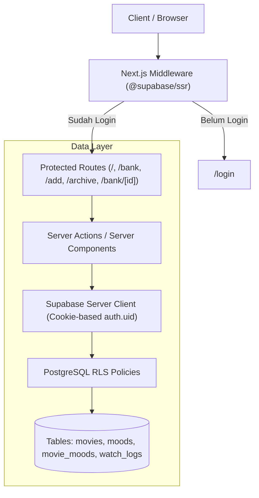

# Rencana Implementasi Phase 2: Database + Auth + CRUD Persisten (MOCAB)

## 1. Arsitektur & Alur Data



- **Autentikasi**: Single-user dengan `@supabase/ssr` menggunakan session cookies (`createServerClient` dan `createBrowserClient`).
- **Middleware**: Memeriksa sesi pengguna via `middleware.ts`. Jika belum login, redirect ke `/login`.
- **Akses Data (`lib/movies.ts`)**:
  - Di-refactor untuk beroperasi secara langsung dengan Supabase Server Client / Server Actions.
  - Mempertahankan signature fungsi: `listMovies()`, `getMovie(id)`, `addMovie(input)`, `updateMovieMoods(id, moods)`, `saveLog(id, logData)`, `deleteMovie(id)`, ditambah `listMoods()` dan `createMood(name)`.
  - Validasi ketat di sisi server (judul film, minimal 1 mood, rentang rating 1-10, tautan http/https, nama mood 1-24 karakter).
- **Klien**: Halaman Server Component mengambil data langsung (zero client fetch latency), sedangkan interaksi form (tambah film, catat review, tambah mood, hapus) menggunakan Server Actions atau API adapter yang memanggil `lib/movies.ts`.

---

## 2. Struktur Folder & File Baru

```
Movie Cabin/
├── supabase/
│   ├── README.md                                  # Panduan migrasi SQL & setup .env.local
│   └── migrations/
│       └── 20261028000000_phase2_init_schema.sql  # DDL movies, moods, movie_moods, watch_logs, RLS, functions
├── src/
│   ├── app/
│   │   ├── login/
│   │   │   └── page.tsx                           # Halaman login (email & password, MOCAB design tokens)
│   │   ├── auth/
│   │   │   └── signout/route.ts                   # Route handler untuk sign out bersih
│   ├── components/
│   │   ├── Header.tsx                             # Header minimalis dengan tombol Keluar / status akun
│   │   ├── LoadingSpinner.tsx                     # Indikator loading nyata sesuai token visual
│   │   ├── ErrorDisplay.tsx                       # Tampilan error informatif berbahasa Indonesia
│   │   └── views/
│   │       └── ... (update integrasi custom mood & async actions)
│   ├── lib/
│   │   ├── supabase/
│   │   │   ├── server.ts                          # createServerClient (@supabase/ssr)
│   │   │   ├── client.ts                          # createBrowserClient (@supabase/ssr)
│   │   │   └── middleware.ts                      # Session update & route protection
│   │   ├── movies.ts                              # Implementasi CRUD ke Supabase
│   │   └── moods.ts                               # Pengelolaan mood dan custom mood
│   ├── middleware.ts                              # Root middleware pemicu perlindungan route
│   └── types/
│       └── index.ts                               # Update Movie.id ke string (UUID), Mood type
├── .env.example                                   # Template environment variables
└── docs/
    ├── PROJECT_RULES.md                           # Update aturan Phase 2
    └── BACKLOG.md
```

---

## 3. Rincian Skema Database (`supabase/migrations/20261028000000_phase2_init_schema.sql`)

### A. Tabel `movies`
- `id`: `uuid primary key default gen_random_uuid()`
- `user_id`: `uuid not null references auth.users(id) on delete cascade default auth.uid()`
- `tmdb_id`: `integer null`
- `title`: `text not null`
- `release_year`: `integer null`
- `runtime`: `integer null`
- `synopsis`: `text`
- `source_url`: `text`
- `watch_url`: `text`
- `status`: `text not null default 'unwatched' check (status in ('unwatched', 'watched'))`
- `created_at`: `timestamptz not null default now()`
- `updated_at`: `timestamptz not null default now()`
- **Constraint Unik**:
  - `CREATE UNIQUE INDEX movies_user_tmdb_unique ON movies (user_id, tmdb_id) WHERE tmdb_id IS NOT NULL;`
  - Validasi duplikasi manual (bila `tmdb_id is null`): ditolak di server jika `lower(title)` dan `release_year` sama untuk user yang sama.

### B. Tabel `moods`
- `id`: `uuid primary key default gen_random_uuid()`
- `user_id`: `uuid not null references auth.users(id) on delete cascade default auth.uid()`
- `name`: `text not null check (char_length(trim(name)) >= 1 and char_length(trim(name)) <= 24)`
- `slug`: `text not null`
- `created_at`: `timestamptz not null default now()`
- **Constraint Unik**:
  - `CREATE UNIQUE INDEX moods_user_lower_name_unique ON moods (user_id, lower(trim(name)));`

### C. Tabel `movie_moods`
- `movie_id`: `uuid not null references movies(id) on delete cascade`
- `mood_id`: `uuid not null references moods(id) on delete cascade`
- `primary key (movie_id, mood_id)`
- Aturan minimal 1 mood dijaga di lapisan server sebelum transaksi commit.

### D. Tabel `watch_logs`
- `id`: `uuid primary key default gen_random_uuid()`
- `user_id`: `uuid not null references auth.users(id) on delete cascade default auth.uid()`
- `movie_id`: `uuid not null references movies(id) on delete cascade`
- `watched_at`: `timestamptz not null default now()`
- `movie_rating`: `integer not null check (movie_rating >= 1 and movie_rating <= 10)`
- `content_potential`: `integer not null check (content_potential >= 1 and content_potential <= 10)`
- `theme`: `text`
- `scene`: `text`
- `angle`: `text`
- `notes`: `text`
- `created_at`: `timestamptz not null default now()`
- `updated_at`: `timestamptz not null default now()`
- **Constraint Unik**:
  - `unique (movie_id)` (1 log per film di MVP, skema mendukung pelepasan constraint untuk riwayat rewatch di masa depan).

### E. Trigger `updated_at` & Fungsi `ensure_default_moods(p_user_id)`
- Trigger otomatis untuk memperbarui `updated_at` pada tabel `movies` dan `watch_logs`.
- Fungsi `ensure_default_moods(p_user_id uuid)`:
  Menyisipkan 7 mood default: `['Psikologis', 'Emosional', 'Romantis', 'Coming of Age', 'Gelap', 'Intens', 'Reflektif']` jika user belum memiliki mood.

### F. Row Level Security (RLS)
- RLS diaktifkan (`ENABLE ROW LEVEL SECURITY`) pada seluruh tabel: `movies`, `moods`, `movie_moods`, `watch_logs`.
- Policy:
  - `movies`: `user_id = auth.uid()` untuk SELECT, INSERT, UPDATE, DELETE.
  - `moods`: `user_id = auth.uid()` untuk SELECT, INSERT, UPDATE, DELETE.
  - `movie_moods`: Memvalidasi kepemilikan film induk dan mood:
    `EXISTS (SELECT 1 FROM movies WHERE movies.id = movie_moods.movie_id AND movies.user_id = auth.uid())`
  - `watch_logs`: `user_id = auth.uid()` DAN `EXISTS (SELECT 1 FROM movies WHERE movies.id = watch_logs.movie_id AND movies.user_id = auth.uid())`.
