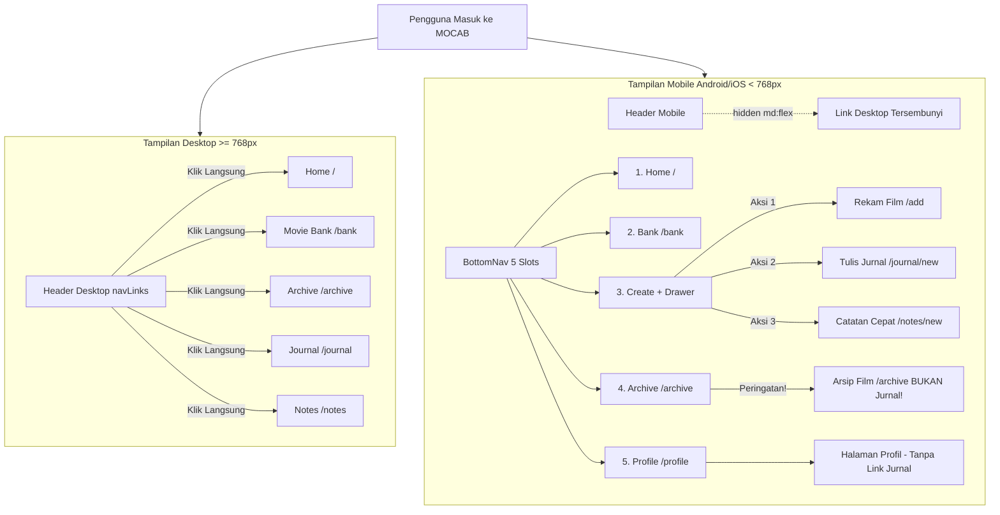
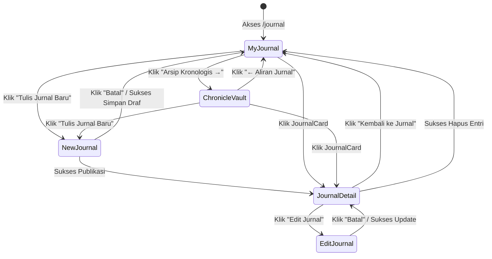

# MOCAB — Mobile Journal Navigation Audit Report

> **Document Version:** 1.0.0  
> **Date:** November 9, 2026  
> **Status:** AUDIT COMPLETED  
> **Target Release:** MOCAB Phase 15 (Mobile UI/UX Refinement)  
> **Author:** Antigravity AI Assistant & Engineering Team  
> **Verdict:** `PASS — Root cause ditemukan dan solusi jelas.`

---

## 1. Executive Summary & Audit Verdict

### Final Verdict: `PASS — Root cause ditemukan dan solusi jelas`

Berdasarkan investigasi menyeluruh pada codebase MOCAB (Next.js App Router), akar permasalahan dari laporan **"Pengguna tidak dapat mengakses halaman daftar Journal melalui tampilan Android"** telah berhasil diidentifikasi secara pasti.

Fitur Journal (`/journal`, `/journal/archive`, `/journal/new`, `/journal/[id]`, `/journal/[id]/edit`) telah terimplementasi dengan lengkap beserta navigasi internalnya. Namun, **jalur masuk (entry point) dari level global/shell menuju halaman daftar `/journal` pada breakpoint mobile (< 768px) terputus 100%**:

1. **Header Desktop Nav Disembunyikan di Mobile:** Link `Journal` (`/journal`) dan `Notes` (`/notes`) hanya tersedia di bar navigasi desktop yang diatur dengan kelas `hidden md:flex`. Pada viewport mobile (Android/iOS), navigasi ini disembunyikan sepenuhnya tanpa adanya mobile menu (hamburger/drawer).
2. **Bottom Navigation Tidak Memiliki Slot Journal:** `BottomNav.tsx` memiliki 5 slot: `Home` (`/`), `Bank` (`/bank`), `+` (Creation Drawer Trigger), `Archive` (`/archive`), dan `Profile` (`/profile`). Slot `Archive` mengarah ke `/archive` (Arsip Catatan Tontonan Film / *The Writer's Room Research Notes*), **bukan** ke Chronicle Vault Jurnal (`/journal/archive`) atau My Journal (`/journal`).
3. **Creation Drawer Hanya Membuka Form Baru:** Tombol "Tulis Jurnal" pada `CreationDrawer.tsx` mengarah langsung ke editor entri baru (`/journal/new`). Tidak ada opsi untuk melihat daftar jurnal yang sudah tersimpan.
4. **Halaman Profile Tidak Memiliki Shortcut Curation:** Halaman `/profile` (slot ke-5 BottomNav) saat ini hanya memuat data akun, statistik film, toggle tema, PWA, tentang MOCAB, dan tombol keluar. Belum ada kartu atau tautan menuju `My Journal` (`/journal`) maupun `Personal Notes` (`/notes`).

Akibatnya, pengguna Android **tidak memiliki tombol, kartu, atau tautan langsung apa pun** untuk membuka `/journal` kecuali dengan trik tidak intuitif (membuka form tulis baru lalu menekan tombol "Batal", atau mencari entri lewat Global Search jika sudah pernah menulis jurnal sebelumnya).

---

## 2. Root Cause Analysis

### 2.1. Arsitektur Shell Navigasi: Desktop vs Mobile

MOCAB menerapkan arsitektur navigasi responsif bercabang:



### 2.2. Pembagian Akar Masalah

| No | Komponen / Lokasi | Kode Saat Ini | Dampak pada Pengguna Android |
| :-: | :--- | :--- | :--- |
| **1** | `src/components/Header.tsx` (baris 68) | `<nav className="hidden md:flex items-center gap-1">` | Tautan navigasi `/journal` lenyap saat layar < 768px. |
| **2** | `src/components/BottomNav.tsx` (baris 108–128) | `<Link href="/archive" data-testid="bottomnav-archive">` | Slot ke-4 mengarah ke `/archive` (Arsip Creator Film), tidak ada rute ke `/journal`. |
| **3** | `src/components/CreationDrawer.tsx` (baris 209–245) | `<Link href="/journal/new">Tulis Jurnal</Link>` | Hanya menyediakan aksi pembuatan entri baru; tidak ada tautan ke daftar jurnal. |
| **4** | `src/components/views/ProfileView.tsx` | Belum ada seksi kurasi Jurnal/Notes | Slot Profil yang selalu dapat diakses di mobile belum dimanfaatkan sebagai hub kurasi pribadi. |
| **5** | `src/components/Footer.tsx` (baris 64–80) | Tautan cepat footer hanya: `/`, `/bank`, `/archive`, `/add` | Tidak ada tautan ke `/journal` di footer mobile. |

---

## 3. Komponen dan File yang Terlibat

### 1. `src/components/BottomNav.tsx`
- **Peran:** Navigasi utama bawah pada mobile (`fixed bottom-0 md:hidden`).
- **Pemeriksaan Slot:**
  - Slot 1: `href="/"` (Home) — Berfungsi normal.
  - Slot 2: `href="/bank"` (Bank) — Berfungsi normal.
  - Slot 3: Tombol `+` (Membuka `CreationDrawer`) — Berfungsi normal.
  - Slot 4: `href="/archive"` (Label: "Archive", aria-label: "Arsip Creator") — **Mengarah ke `/archive`**, yaitu arsip film yang sudah ditonton dan memiliki catatan riset `watch_logs`. **Bukan** Chronicle Vault Jurnal (`/journal/archive`).
  - Slot 5: `href="/profile"` (Profil) — Berfungsi normal menuju `/profile`.
- **Temuan:** Tidak ada tautan ke `/journal` maupun `/journal/archive` di BottomNav.

### 2. `src/components/Header.tsx`
- **Peran:** Header sticky atas di semua halaman.
- **Pemeriksaan:**
  - Menyimpan array `navLinks` lengkap: `Home`, `Movie Bank`, `Archive`, `Journal`, `Notes`.
  - Mengisolasi link tersebut di dalam `<nav className="hidden md:flex">`.
  - Pada breakpoint mobile, Header hanya menyisakan logo kiri, tombol pencarian (`sm:hidden`), `ThemeToggle`, dan tombol `Keluar`.
- **Temuan:** Tidak tersedia menu mobile atau drawer sekunder di Header untuk mengakses `/journal`.

### 3. `src/components/CreationDrawer.tsx`
- **Peran:** Bottom sheet menu kreasi cepat dari tombol `+` BottomNav.
- **Pemeriksaan:**
  - Action 1: `Rekam Film Baru` (`href="/add"`).
  - Action 2: `Tulis Jurnal` (`href="/journal/new"`).
  - Action 3: `Catatan Cepat` (`href="/notes/new"`).
- **Temuan:** Aksi "Tulis Jurnal" hanya membuka halaman editor formulir entri baru. Pengguna tidak diberikan opsi atau tautan sekunder untuk membuka daftar entri yang sudah ada (`/journal`).

### 4. `src/components/views/ProfileView.tsx` & `src/app/profile/page.tsx`
- **Peran:** Halaman profil kurator yang ditautkan langsung pada Slot 5 BottomNav.
- **Pemeriksaan:**
  - Hanya merender Section A (Identitas Akun), Section B (Statistik Film), Section C (Tema), Section C.2 (PWA), Section D (About), dan Section E (Logout).
  - Tidak memiliki tautan atau shortcut apa pun menuju `/journal`, `/journal/archive`, atau `/notes`.
- **Temuan:** Slot 5 BottomNav (Profil) adalah lokasi paling ideal, terstruktur, dan konsisten untuk menempatkan hub akses cepat ke **My Journal** dan **Chronicle Vault** tanpa mengubah batasan 5 slot BottomNav.

---

## 4. Analisis Jalur Navigasi

### A. Jalur Navigasi yang Saat Ini Tersedia

| No | Dari | Menuju | Media / Elemen Pemicu | Status di Mobile |
| :-: | :--- | :--- | :--- | :---: |
| 1 | Halaman Mana Pun (Desktop) | `/journal` | Klik `Journal` di Desktop Header | ✅ Berfungsi (Desktop Saja) |
| 2 | Halaman Mana Pun (Mobile) | `/journal/new` | BottomNav `(+)` → `CreationDrawer` → "Tulis Jurnal" | ✅ Berfungsi |
| 3 | `/journal/new` (Editor Baru) | `/journal` | Klik tombol "Batal" di pojok kiri atas formulir | ⚠️ Berfungsi (Tapi ini jalan memutar / workaround) |
| 4 | `/journal` (Stream) | `/journal/archive` | Klik tombol "Arsip Kronologis →" di header view | ✅ Berfungsi |
| 5 | `/journal/archive` (Vault) | `/journal` | Klik tombol "← Aliran Jurnal" di header view | ✅ Berfungsi |
| 6 | `/journal` atau `/journal/archive` | `/journal/[id]` | Klik kartu `JournalCard` | ✅ Berfungsi |
| 7 | `/journal/[id]` (Detail) | `/journal` | Klik "← Kembali ke Jurnal" di breadcrumb atas / bawah | ✅ Berfungsi |
| 8 | `/journal/[id]` (Detail) | `/journal/[id]/edit`| Klik tombol "Edit Jurnal" | ✅ Berfungsi |
| 9 | `/journal/[id]/edit` (Editor) | `/journal/[id]` | Klik tombol "Batal" di formulir edit | ✅ Berfungsi |
| 10 | `/bank/[id]` (Detail Film) | `/journal/[id]` | Bagian "Journal Kurator" (jika film memiliki relasi jurnal terbit) | ✅ Berfungsi (Kondisional) |
| 11 | SearchModal (Global Search) | `/journal/[id]` | Mencari kata kunci jurnal di tab "Jurnal" atau "Semua" | ✅ Berfungsi (Kondisional) |

### B. Jalur Navigasi yang Hilang (The Missing Links)

| No | Jalur yang Hilang | Dampak User Experience di Mobile |
| :-: | :--- | :--- |
| **1** | **Mobile Shell → `/journal`** | Pengguna Android tidak memiliki tombol langsung untuk membuka daftar jurnal dari beranda atau halaman utama aplikasi. |
| **2** | **Creation Drawer → `/journal`** | Pengguna yang menekan `(+)` dan ingin membaca catatan lama tidak menemukan tautan "Lihat Semua Jurnal". |
| **3** | **Profile → `/journal` & `/journal/archive`** | Pengguna yang memeriksa profil kuratornya di Slot 5 tidak menemukan ruang refleksi batin/jurnal pribadinya. |
| **4** | **BottomNav Slot 4 Ambiguity** | Label "Archive" di BottomNav membingungkan pengguna: pengguna mengira itu adalah Chronicle Vault Jurnal, namun kenyataannya membuka Arsip Film Watched Log. |

---

## 5. Audit Navigasi Antarhalaman Fitur Journal

Audit mendalam terhadap integritas internal suite Journal menunjukkan bahwa seluruh navigasi antar-subhalaman Journal telah lengkap dan berjalan sempurna:



### Kesimpulan Navigasi Antarhalaman
- **Journal List (`/journal`) ↔ Journal Detail (`/journal/[id]`):** Berjalan lancar 100%.
- **Journal List (`/journal`) ↔ Journal Editor (`/journal/new`):** Berjalan lancar 100%.
- **Journal Detail (`/journal/[id]`) ↔ Journal List (`/journal`):** Berjalan lancar 100%.
- **Journal Archive (`/journal/archive`) ↔ Journal List (`/journal`):** Berjalan lancar 100%.
- **Journal Detail (`/journal/[id]`) ↔ Journal Editor (`/journal/[id]/edit`):** Berjalan lancar 100%.

**Satu-satunya masalah adalah: bagaimana pengguna mobile pertama kali masuk ke dalam diagram state di atas dari luar suite.**

---

## 6. Audit Viewport Mobile & Breakpoint Android

Pemeriksaan dilakukan pada spektrum breakpoint Android:
- **320px** (Layar ultra-kecil)
- **360px** (Layar standar hemat / Galaxy seri A/M)
- **390px – 412px** (Layar standar Android modern: Pixel, Samsung Galaxy S21–S24, Xiaomi)
- **430px** (Layar besar Android Plus/Ultra)

### Temuan Viewport:
1. **Tidak Ada Elemen yang Tertimpa di Bawah:**
   `Footer.tsx` telah memiliki padding aman:
   `pb-[calc(96px+env(safe-area-inset-bottom))]`
   sehingga tidak ada tautan atau teks footer yang tertutup oleh `BottomNav`.
2. **BottomNav Fixed Grid:**
   `BottomNav.tsx` menggunakan `grid grid-cols-5` dengan ukuran tombol `min-h-[44px]` dan trigger tengah `w-[48px] h-[48px]`. Secara tata letak visual sangat solid dan tidak mengalami tabrakan elemen.
3. **Penyebab Eksklusif Adalah Logika Tautan:**
   Bukan karena z-index, bukan karena pointer-events non-aktif, dan bukan karena elemen keluar layar (overflow-hidden). Masalah murni karena **elemen tautan `/journal` tidak pernah di-render pada DOM pohon komponen mobile**.

---

## 7. Rekomendasi Solusi Paling Minimal & Konsisten

Sesuai instruksi dan batasan proyek MOCAB:
- Pertahankan **5 slot BottomNav**.
- Jangan mengubah route yang sudah ada.
- Jangan mengubah desain desktop.
- Jangan membuat database migration atau table baru.
- Jangan mengubah business logic Journal.
- Gunakan design system MOCAB yang sudah ada (Retro VHS Cinema).

### Solusi Rekomendasi Utama (Approach Konsisten via ProfileView & CreationDrawer)

#### 1. Tambahkan Seksi "Ruang Tulis & Refleksi Sinema" di `ProfileView.tsx`
Di dalam `src/components/views/ProfileView.tsx`, tambahkan kartu navigasi kurator setelah Section B (Collection Statistics) atau sebelum Section C (Tema Tampilan):
- **Kartu 1: My Journal (Catatan Harian)**
  - Tautan utama: `/journal`
  - Sub-tautan: `Chronicle Vault (/journal/archive)`
  - Deskripsi: "Renungan batin, fragmen emosional harian, dan resonansi personal dengan film yang disimak."
  - Desain: Card bergaya Retro VHS dengan badge `JOURNAL // REFLECTION` dan border lavender/neon-magenta.
- **Kartu 2: Catatan Pribadi (Personal Notes)**
  - Tautan utama: `/notes`
  - Deskripsi: "Papan memo scratchpad untuk menangkap ide kilat dan kutipan inspirasi sinema."
  - Desain: Card bergaya Retro VHS dengan badge `MEMO // SCRATCHPAD` dan border amber.

**Keunggulan Solusi Profile:**
- Slot 5 BottomNav (`Profile`) dapat diakses hanya dengan **1 ketukan jari** dari halaman mana pun di aplikasi mobile.
- Memberikan tempat bernaung yang sangat logis dan personal bagi jurnal reflektif serta catatan kurator.
- Tidak mengutak-atik 5 slot `BottomNav` maupun route `/archive` yang sudah berjalan.

#### 2. Tambahkan Tautan Sekunder "Buka Jurnal Saya" di `CreationDrawer.tsx`
Di bagian bawah `CreationDrawer.tsx` (di bawah 3 kartu aksi kreasi), tambahkan tautan footer ringkas:
```tsx
<div className="pt-3 border-t border-line/60 flex items-center justify-between text-xs">
  <span className="text-muted">Ingin melihat entri sebelumnya?</span>
  <Link
    href="/journal"
    onClick={onClose}
    className="font-medium text-neon-magenta hover:underline flex items-center gap-1"
  >
    <span>Buka Jurnal Saya</span>
    <span>→</span>
  </Link>
</div>
```

**Keunggulan Solusi Creation Drawer:**
- Menghilangkan friksi bagi pengguna yang menekan tombol `(+)` dengan niat melihat jurnal lamanya alih-alih membuat yang baru.

#### 3. Tambahkan Tautan Jurnal pada `Footer.tsx`
Pada baris tautan cepat `Footer.tsx` (baris 64–80):
Tambahkan `Journal` (`/journal`) dan `Notes` (`/notes`) ke dalam baris tautan cepat footer agar pengguna yang menggulir halaman ke bawah di mobile juga dapat mengakses jurnal dengan cepat.

---

## 8. Daftar File yang Perlu Diubah pada Tahap Implementasi

Hanya **3 file frontend** yang perlu diperbarui secara minimal tanpa ada efek samping pada database atau route:

1. `src/components/views/ProfileView.tsx`
   - Menambahkan seksi hub navigasi "Ruang Tulis & Refleksi Sinema" yang berisi kartu tautan langsung ke `/journal` (My Journal), `/journal/archive` (Chronicle Vault), dan `/notes` (Personal Notes).
2. `src/components/CreationDrawer.tsx`
   - Menambahkan tautan footer sekunder di bawah 3 kartu aksi untuk membuka daftar `/journal` dan `/notes`.
3. `src/components/Footer.tsx`
   - Menambahkan link `Journal` (`/journal`) dan `Notes` (`/notes`) pada navigasi footer untuk melengkapi tautan cepat global.

---

## 9. Rencana Verifikasi Pengujian

Pada tahap implementasi berikutnya, buat file uji otomatis:
`tests/phase15_mobile_journal_nav.test.mjs`

Pengujian akan memverifikasi:
1. `ProfileView.tsx` me-render tautan `href="/journal"`, `href="/journal/archive"`, dan `href="/notes"`.
2. `CreationDrawer.tsx` me-render tautan navigasi ke `/journal`.
3. `Footer.tsx` memuat tautan cepat ke `/journal`.
4. Seluruh suite pengujian `npm test` (185+ test), `npm run type-check`, `npm run lint`, dan `npm run build` tetap lulus 100%.

---

## 10. Konfirmasi Batasan & Status Akhir

**STATUS: AUDIT SELESAI & STOP CONDITION DITERAPKAN.**  
- Tidak ada modifikasi kode yang dilakukan pada tahap ini.  
- Tidak ada database migration yang dibuat.  
- Tidak ada commit atau push ke Git.  
- Menunggu arahan dan persetujuan pengguna untuk melanjutkan ke tahap implementasi perbaikan.
