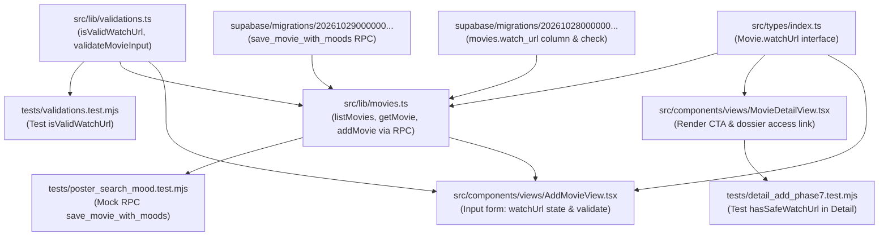

# MOCAB — Phase 16.0: Watch Sources Architecture & Implementation Audit

> **Document Version:** 1.0.0  
> **Date:** November 13, 2026  
> **Repository:** MOCAB (Movie Cabin)  
> **Target Branch:** `master`  
> **Baseline Commit:** `8d71e72` (`feat: complete phase 15 mobile ux redesign`)  
> **Author:** Antigravity AI Assistant & Engineering Team  
> **Verdict:** `PASS — Arsitektur saat ini dipahami dan implementasi dapat direncanakan.`

---

## 1. Executive Summary

Audit arsitektur ini dilakukan secara **READ-ONLY** untuk menganalisis fondasi teknis, kelemahan, dan strategi implementasi fitur **Watch Sources / Watch Links** pada MOCAB (Movie Cabin) sebelum melangkah ke Phase 16.1 (Database Migration) dan Phase 16.2 (UI/UX Implementation).

### Masalah Utama yang Ditemukan pada Arsitektur Saat Ini
1. **Tidak Ada Fitur Edit Watch Link:** Sekali film disimpan melalui `/add`, kolom `watch_url` pada tabel `movies` tidak dapat diubah oleh kurator melalui UI mana pun. Tidak ada Server Action atau form untuk memutakhirkan URL tontonan.
2. **Keterbatasan Single Link:** Satu film hanya mendukung satu tautan tontonan tunggal berupa string bebas di kolom `movies.watch_url`.
3. **Ketiadaan Metadata Platform & Akses:** Kurator tidak dapat mencatat nama platform (misal: *Netflix*, *Prime Video*, *Criterion Channel*, *Kaset VHS Fisik*) maupun jenis akses (*Subscription*, *Rent*, *Buy*, *Free*, *Physical*).
4. **Kolom Zombie `source_url`:** Kolom `source_url` ada di tabel `movies` sejak Phase 2, tetapi selalu diisi `null` oleh Server Action dan tidak pernah digunakan oleh UI aplikasi.
5. **Validasi URL Minimalis:** Validasi hanya menggunakan regex sederhana `^https?://\S+$` tanpa parsing `new URL()`, tanpa normalisasi protokol/domain, dan tanpa sanitasi tracking parameter.

### Solusi Rekomendasi
Mengimplementasikan tabel relasional baru `public.movie_watch_sources` dengan foreign key ke `public.movies(id)`, RLS ketat berbasis `auth.uid()`, partial unique index untuk menjamin **tepat satu sumber utama (`is_primary = true`) per film**, serta migrasi data lama `movies.watch_url` secara **idempoten** tanpa merusak backward compatibility.

---

## 2. Current Database Architecture

Berdasarkan audit terhadap berkas migrasi Supabase di `supabase/migrations/`:
- `20261028000000_phase2_init_schema.sql`
- `20261028000001_phase2_security_patch.sql`
- `20261029000000_fix_mood_rls_and_movie_poster.sql`
- `20261108000000_phase14_journal_and_notes.sql`

Berikut struktur database aktif yang relevan:

### 2.1. Tabel `public.movies`
Didefinisikan pada `supabase/migrations/20261028000000_phase2_init_schema.sql` (baris 29–52):
```sql
create table if not exists public.movies (
  id uuid primary key default gen_random_uuid(),
  user_id uuid not null references auth.users(id) on delete cascade default auth.uid(),
  tmdb_id integer null,
  title text not null check (char_length(trim(title)) >= 1 and char_length(title) <= 200),
  release_year integer null check (release_year is null or (release_year >= 1870 and release_year <= 2100)),
  runtime integer null check (runtime is null or runtime > 0),
  synopsis text null default '' check (synopsis is null or char_length(synopsis) <= 3000),
  source_url text null default null check (
    source_url is null or (
      char_length(source_url) <= 2048
      and source_url ~* '^https?://\S+$'
    )
  ),
  watch_url text null default null check (
    watch_url is null or (
      char_length(watch_url) <= 2048
      and watch_url ~* '^https?://\S+$'
    )
  ),
  status text not null default 'unwatched' check (status in ('unwatched', 'watched')),
  created_at timestamptz not null default now(),
  updated_at timestamptz not null default now()
);
```
*Catatan:* Pada migrasi `20261029000000_fix_mood_rls_and_movie_poster.sql` (baris 11–13), ditambahkan kolom `poster_path text null`.

### 2.2. Temuan Arsitektur Database Terkait Sumber Tontonan
1. **Kolom `movies.watch_url`:** Masih aktif sebagai kolom teks opsional, dibatasi maksimal 2048 karakter dan regex `^https?://\S+$`.
2. **Kolom `movies.source_url`:** Masih ada di skema tabel, namun bernilai NULL di seluruh data operasional aplikasi.
3. **Tabel Watch Sources:** **BELUM ADA** tabel watch sources dalam basis data.
4. **Relasi Kepemilikan (User Ownership):** Setiap baris di `movies` terikat langsung ke `user_id uuid references auth.users(id) on delete cascade`.
5. **Kebijakan Row Level Security (RLS):**
   - `SELECT`: `user_id = auth.uid()`
   - `INSERT`: `with check (user_id = auth.uid())`
   - `UPDATE`: `using (user_id = auth.uid()) with check (user_id = auth.uid())`
   - `DELETE`: `using (user_id = auth.uid())`
   Seluruh tabel schema `public` telah di-`REVOKE` hak aksesnya dari role `anon` (`20261028000001_phase2_security_patch.sql` baris 20).
6. **Stored Procedures / RPC yang Menyentuh `watch_url`:**
   - `public.save_movie_with_moods(...)` didefinisikan ulang pada `20261029000000_fix_mood_rls_and_movie_poster.sql` (baris 42–130) dengan parameter `p_watch_url text default null`.
   - RPC ini melakukan pembersihan `v_clean_watch := nullif(trim(coalesce(p_watch_url, '')), '');` dan memasukkannya langsung ke `movies.watch_url`.

---

## 3. Existing Watch Link Implementation

### 3.1. Alur Pembuatan (Creation Flow)
1. **Input Pengguna:** Form pada [`src/components/views/AddMovieView.tsx`](file:///c:/Users/Hype/Documents/PROJECT/Movie%20Cabin/src/components/views/AddMovieView.tsx#L852-L871) menyediakan input opsional *"4. Tautan Nonton"*:
   - State: `const [watchUrl, setWatchUrl] = useState('');` (baris 65).
   - Validasi Form: `const cleanUrl = watchUrl.trim();` (baris 290). Jika tidak kosong, memvalidasi dengan `isValidWatchUrl(cleanUrl)` (baris 291).
2. **Server Action Dispatch:** Memanggil `addMovie(...)` pada [`src/lib/movies.ts`](file:///c:/Users/Hype/Documents/PROJECT/Movie%20Cabin/src/lib/movies.ts#L161-L204):
   - Validasi Input Server: `validateMovieInput(input)` pada [`src/lib/validations.ts`](file:///c:/Users/Hype/Documents/PROJECT/Movie%20Cabin/src/lib/validations.ts#L43-L85).
   - RPC Call: Menjalankan `supabase.rpc('save_movie_with_moods', { p_watch_url: cleanUrl || null, ... })`.
3. **Penyimpanan Database:** Disimpan langsung ke kolom `movies.watch_url`.

### 3.2. Alur Pembacaan & Tampilan (Read & Display Flow)
1. **Query Data:**
   - [`src/lib/movies.ts`](file:///c:/Users/Hype/Documents/PROJECT/Movie%20Cabin/src/lib/movies.ts#L35): `listMovies()` memilih kolom `watch_url` dan memetakan ke interface `watchUrl: row.watch_url || ''` (baris 73).
   - [`src/lib/movies.ts`](file:///c:/Users/Hype/Documents/PROJECT/Movie%20Cabin/src/lib/movies.ts#L102): `getMovie(id)` memilih kolom `watch_url` dan memetakan ke `watchUrl: data.watch_url || ''` (baris 139).
2. **Rendering UI pada Movie Detail:**
   Pada [`src/components/views/MovieDetailView.tsx`](file:///c:/Users/Hype/Documents/PROJECT/Movie%20Cabin/src/components/views/MovieDetailView.tsx):
   - Pengecekan Aman: `const hasSafeWatchUrl = /^https?:\/\/\S+$/i.test(movie.watchUrl || '');` (baris 76).
   - **Tombol Aksi Mobile (baris 170–190):** Jika valid, merender tombol CTA utama *"Buka Tautan Nonton"* dengan `href={movie.watchUrl}`, `target="_blank"`, `rel="noopener noreferrer"`. Jika tidak ada URL, tombol dinonaktifkan (*disabled*) bertuliskan *"Belum ada tautan nonton"*.
   - **Tombol Aksi Desktop (baris 239–259):** Merender tombol CTA *"Buka Tautan Nonton"* di bawah poster utama.
   - **Dossier Reference Section (baris 359–380):** Merender seksi *"Tautan Akses"* yang menampilkan URL lengkap.

### 3.3. Evaluasi Fungsionalitas Saat Ini
| Fitur | Status Saat Ini | Analisis |
| :--- | :---: | :--- |
| **Input Watch Link saat Add Movie** | ✅ Ada | Tersedia di form `/add`, opsional. |
| **Buka Link dari Detail Film** | ✅ Ada | Tersedia di tampilan mobile dan desktop. |
| **Edit Watch Link** | ❌ **TIDAK ADA** | Pengguna tidak dapat mengubah URL setelah film dibuat. |
| **Hapus Watch Link** | ❌ **TIDAK ADA** | Pengguna tidak dapat menghapus atau mengosongkan link. |
| **Multiple Sources (Banyak Sumber)** | ❌ **TIDAK ADA** | Hanya 1 link per film. |
| **Nama Platform (Platform Name)** | ❌ **TIDAK ADA** | Tidak tersimpan, hanya raw URL string. |
| **Jenis Akses (Access Type)** | ❌ **TIDAK ADA** | Tidak ada klasifikasi langganan/beli/sewa/gratis. |
| **Sumber Utama (Primary Source)** | ⚠️ Implisit | Karena hanya 1 link, secara default menjadi satu-satunya sumber. |

---

## 4. Source Code Dependency Map

Peta ketergantungan lengkap berkas yang menyentuh `watch_url` / `watchUrl`:



### Detail Baris Kritis per Berkas:
1. **[`src/types/index.ts`](file:///c:/Users/Hype/Documents/PROJECT/Movie%20Cabin/src/types/index.ts#L18):**
   - Baris 18: `watchUrl: string;` di dalam interface `Movie`.
2. **[`src/lib/validations.ts`](file:///c:/Users/Hype/Documents/PROJECT/Movie%20Cabin/src/lib/validations.ts#L32-L71):**
   - Baris 32–38: Fungsi `isValidWatchUrl(url?: string | null): boolean`.
   - Baris 46: Parameter `watchUrl?: string;` pada `validateMovieInput`.
   - Baris 68–71: Pengecekan `if (cleanUrl && !isValidWatchUrl(cleanUrl))`.
3. **[`src/lib/movies.ts`](file:///c:/Users/Hype/Documents/PROJECT/Movie%20Cabin/src/lib/movies.ts#L35):**
   - Baris 35: Query `watch_url` di `listMovies`.
   - Baris 73: Mapping `watchUrl: row.watch_url || ''`.
   - Baris 102: Query `watch_url` di `getMovie`.
   - Baris 139: Mapping `watchUrl: data.watch_url || ''`.
   - Baris 154: `watchUrl?: string;` pada `AddMovieInput`.
   - Baris 185: `p_watch_url: cleanUrl || null` pada pemanggilan RPC `save_movie_with_moods`.
4. **[`src/components/views/AddMovieView.tsx`](file:///c:/Users/Hype/Documents/PROJECT/Movie%20Cabin/src/components/views/AddMovieView.tsx#L65):**
   - Baris 65: State `watchUrl`.
   - Baris 290–305: Handler submit form yang mengirim `watchUrl`.
   - Baris 853–871: Elemen `<input id="au">` untuk URL tontonan.
5. **[`src/components/views/MovieDetailView.tsx`](file:///c:/Users/Hype/Documents/PROJECT/Movie%20Cabin/src/components/views/MovieDetailView.tsx#L76):**
   - Baris 76: `const hasSafeWatchUrl = /^https?:\/\/\S+$/i.test(movie.watchUrl || '');`.
   - Baris 170–190: Tombol CTA mobile.
   - Baris 239–259: Tombol CTA desktop.
   - Baris 359–380: Bagian teks dossier "Tautan Akses".

---

## 5. Legacy Data Assessment & Migration Strategy

### 5.1. Analisis Data Eksisting pada `movies.watch_url`
- Film yang sudah ada di database saat ini memiliki `watch_url` berupa `NULL`, string kosong `''`, atau satu URL valid `https://...`.
- Film lama **TIDAK MEMILIKI** kolom `platform_name`, `access_type`, atau penanda `is_primary`.

### 5.2. Kebutuhan Strategi Migrasi (Idempotent Backfill)
Ketika tabel baru `public.movie_watch_sources` dibuat, data lama dari `movies.watch_url` harus dipindahkan secara aman dengan ketentuan:
1. **Penanganan NULL & Empty String:** Hanya baris di mana `m.watch_url IS NOT NULL AND trim(m.watch_url) <> '' AND m.watch_url ~* '^https?://\S+$'` yang di-migrasikan.
2. **Penentuan Platform Cerdas (Auto-Detection):** Gunakan fungsi `CASE WHEN` SQL berdasarkan nama domain URL untuk mengisi `platform_name` secara elegan:
   - `netflix.com` $\rightarrow$ `'Netflix'`
   - `disneyplus.com` $\rightarrow$ `'Disney+'`
   - `primevideo.com` atau `amazon.com` $\rightarrow$ `'Prime Video'`
   - `apple.com` atau `tv.apple.com` $\rightarrow$ `'Apple TV+'`
   - `vidio.com` $\rightarrow$ `'Vidio'`
   - `klikfilm.com` $\rightarrow$ `'KlikFilm'`
   - `bioskoponline.com` $\rightarrow$ `'Bioskop Online'`
   - `youtube.com` atau `youtu.be` $\rightarrow$ `'YouTube'`
   - `mubi.com` $\rightarrow$ `'MUBI'`
   - Lainnya $\rightarrow$ `'Tautan Tontonan'` (atau `'Web Stream'`)
3. **Penanda `is_primary = true`:** Karena data lama hanya berupa satu link, sumber ini otomatis menjadi sumber utama (`is_primary = true`).
4. **Idempotensi (Bisa dijalankan berulang tanpa duplikasi):** Menggunakan klausa `WHERE NOT EXISTS (SELECT 1 FROM public.movie_watch_sources ws WHERE ws.movie_id = m.id)`.
5. **Integritas Kepemilikan (`user_id`):** `user_id` diisi langsung dari `movies.user_id`, menjamin data tidak berpindah tangan.
6. **Backward Compatibility:** Kolom `movies.watch_url` **JANGAN DIHAPUS** pada Phase 16. Kolom ini dipertahankan sebagai fallback atau disinkronkan oleh trigger jika ada query lama yang membacanya.

---

## 6. Security & RLS Assessment

### 6.1. Kepemilikan Data & User Isolation
- Setiap entri pada tabel sumber tontonan **wajib memiliki `user_id` yang terikat ke `auth.uid()`**.
- **Risiko IDOR (Insecure Direct Object Reference):** Pengguna B tidak boleh menambahkan, mengubah, atau menghapus watch source untuk film milik Pengguna A.
- **Pencegahan di Database:**
  1. RLS Policy mewajibkan `user_id = auth.uid()`.
  2. RLS INSERT/UPDATE mewajibkan pengecekan relasi film:
     `EXISTS (SELECT 1 FROM public.movies m WHERE m.id = movie_watch_sources.movie_id AND m.user_id = auth.uid())`.
  3. Database trigger `before insert or update` yang memvalidasi bahwa `NEW.user_id` identik dengan `movies.user_id` dari `NEW.movie_id` (mengikuti pola hardening Phase 14 `validate_journal_movie_ownership`).

### 6.2. Konsistensi Sumber Utama (Single Primary Source Guarantee)
- Film idealnya hanya memiliki **maksimal 1 sumber tontonan utama (`is_primary = true`)**.
- Jika hanya mengandalkan logika aplikasi, terjadi risiko *race condition* yang menyebabkan satu film memiliki 2 sumber dengan `is_primary = true`.
- **Solusi Tingkat Database (Bulletproof):**
  Menggunakan PostgreSQL **Partial Unique Index**:
  ```sql
  create unique index movie_watch_sources_one_primary_idx
    on public.movie_watch_sources (movie_id)
    where (is_primary = true);
  ```
  Indeks ini menjamin di level engine PostgreSQL bahwa tidak ada dua baris untuk `movie_id` yang sama yang dapat memiliki `is_primary = true` secara bersamaan.

### 6.3. Keamanan URL (URL Injection & XSS)
- **Risiko:** URL berbahaya seperti `javascript:alert(1)`, `data:text/html,...`, atau `vbscript:...` yang dapat dieksekusi jika kurator menempelkan tautan berbahaya.
- **Mitigasi Berlapis:**
  1. **Database Check Constraint:** `source_url ~* '^https?://\S+$'` dan `char_length(source_url) <= 2048`.
  2. **Server Action & Sanitizer:** Validasi menggunakan `new URL(url)` untuk memastikan protokolnya strictly `http:` atau `https:`.
  3. **React Link Protection:** Setiap link eksternal selalu menggunakan atribut `target="_blank"` dan `rel="noopener noreferrer"`.

---

## 7. UX Gap Analysis pada Movie Detail

| Komponen UX | Kondisi Saat Ini (Phase 15 Baseline) | Kebutuhan Target (Phase 16) | Rekomendasi Solusi UX |
| :--- | :--- | :--- | :--- |
| **Tombol CTA Nonton** | Membuka `movie.watchUrl` tunggal | Membuka sumber utama (*primary watch source*) secara instan | Tombol utama tetap di posisi saat ini, menampilkan label dinamis: *"Tonton di [Nama Platform Utama]"* atau *"Buka Tautan Nonton"*. |
| **Daftar Sumber Tontonan** | Hanya seksi teks kecil menampilkan 1 URL | Menampilkan seluruh platform tontonan film | Seksi baru *"Sumber Tontonan // Watch Sources"* di Cinema Dossier dengan kartu/baris platform berdesain Retro VHS. |
| **Indikator Platform & Akses** | Tidak ada | Badge platform & badge jenis akses | Badge Silkscreen/font-pixel untuk jenis akses: `SUBSCRIPTION`, `FREE`, `RENT`, `PHYSICAL`. |
| **Aksi Tambah Sumber** | Tidak ada di Movie Detail | Modal / Drawer tambah sumber | Tombol `+ Tambah Sumber Tontonan` yang membuka dialog minimalis untuk memasukkan platform, URL, dan jenis akses. |
| **Aksi Edit Sumber** | Tidak ada | Modal / Drawer edit sumber | Tombol pensil pada setiap baris sumber untuk mengubah URL atau nama platform. |
| **Aksi Hapus Sumber** | Tidak ada | Konfirmasi hapus inline | Menggunakan komponen yang sudah ada: `ConfirmInline` untuk mencegah salah klik. |
| **Tandai Sumber Utama** | Tidak ada | 1-tap set primary | Tombol bintang/radio untuk mengubah sumber utama dengan visual feedback instan. |
| **Responsivitas Mobile (Android)** | Phase 15 shell sudah siap | Tetap responsif pada layar 320px–430px | Setiap baris sumber memiliki area klik $\ge 44\times 44\text{px}$, tanpa overflow horizontal. |

---

## 8. Testing Gap Analysis

### 8.1. Status Test Suite Saat Ini
- Repository memiliki 190 tests (25 suites di `tests/**/*.test.mjs`) yang lulus 100%.
- Pengujian tautan tontonan saat ini hanya terbatas pada:
  - `isValidWatchUrl` regex check di `tests/validations.test.mjs`.
  - Keberadaan `hasSafeWatchUrl` di `tests/detail_add_phase7.test.mjs` dan `tests/phase15_batch2_cinema.test.mjs`.
  - Simulasi `p_watch_url` di `tests/poster_search_mood.test.mjs`.

### 8.2. Kebutuhan Pengujian Baru di Phase 16
1. **Database Schema & Constraints Tests:**
   - Verifikasi partial unique index `is_primary = true`.
   - Verifikasi check constraint `access_type`.
   - Verifikasi cascade delete (jika film dihapus, watch sources ikut terhapus).
2. **Server Action & Validation Tests:**
   - `addWatchSource`: Validasi input, deteksi platform, penanganan primary.
   - `updateWatchSource`: Perubahan URL, platform, dan jenis akses.
   - `deleteWatchSource`: Penghapusan sumber tontonan dan fallback primary jika sumber utama dihapus.
   - `setPrimaryWatchSource`: Pemindahan status primary secara atomik.
3. **URL Validation & Security Tests:**
   - Penolakan skema `javascript:`, `data:`, `file:`.
   - Penolakan string non-URL atau URL > 2048 karakter.
4. **Idempotency Migration Tests:**
   - Verifikasi bahwa script migrasi memindahkan data `movies.watch_url` tanpa membuat duplikasi jika dijalankan ulang.
5. **Component & UX Tests:**
   - Verifikasi rendering multi-source di `MovieDetailView`.
   - Verifikasi area sentuh mobile $\ge 44\times 44\text{px}$.

---

## 9. Recommended Database Architecture

### Evaluasi Rancangan Awal vs Rancangan Rekomendasi

Rancangan awal pengguna:
- `id`, `movie_id`, `user_id`, `platform_name`, `source_url`, `access_type`, `is_primary`, `created_at`, `updated_at`.

### Rekomendasi Arsitektur Database (Final Model Proposal)

Rancangan awal sudah sangat solid, namun perlu diperkaya dengan **check constraints ketat, foreign key cascading, partial unique index, dan cross-table ownership validation**:

```sql
-- ==============================================================================
-- Table: public.movie_watch_sources
-- Menyimpan multi-sumber tontonan per film (streaming, sewa, fisik, dsb.)
-- ==============================================================================

create table if not exists public.movie_watch_sources (
  id uuid primary key default gen_random_uuid(),
  movie_id uuid not null references public.movies(id) on delete cascade,
  user_id uuid not null references auth.users(id) on delete cascade default auth.uid(),
  platform_name text not null check (char_length(trim(platform_name)) >= 1 and char_length(platform_name) <= 100),
  source_url text null default null check (
    source_url is null or (
      char_length(source_url) <= 2048
      and source_url ~* '^https?://\S+$'
    )
  ),
  access_type text not null default 'subscription' check (
    access_type in ('subscription', 'free', 'rent', 'buy', 'cinema', 'physical', 'other')
  ),
  is_primary boolean not null default false,
  notes text null default '' check (notes is null or char_length(notes) <= 500),
  created_at timestamptz not null default now(),
  updated_at timestamptz not null default now()
);

-- Trigger updated_at otomatis menggunakan fungsi yang sudah ada
create trigger set_movie_watch_sources_updated_at
  before update on public.movie_watch_sources
  for each row execute function public.handle_updated_at();

-- Partial Unique Index: Maksimal TEPAT 1 sumber utama per film
create unique index if not exists movie_watch_sources_primary_unique
  on public.movie_watch_sources (movie_id)
  where (is_primary = true);

-- Performance Indexes
create index if not exists movie_watch_sources_movie_idx
  on public.movie_watch_sources (movie_id, is_primary desc, created_at asc);

create index if not exists movie_watch_sources_user_idx
  on public.movie_watch_sources (user_id);
```

### Mengapa Kolom `notes` Ditambahkan?
Banyak kurator film fisik atau arsip lokal ingin mencatat keterangan ringkas seperti *"Kaset VHS di rak studio A"* atau *"Resolusi 4K Remaster"*. Kolom `notes` pendek (maks 500 karakter) memberikan fleksibilitas tinggi tanpa mengorbankan kesederhanaan model.

---

## 10. Recommended Implementation Strategy

Implementasi Phase 16 sebaiknya dipecah menjadi batch-batch terukur:

### Batch 1: Database Migration & Data Services (Phase 16.1)
1. Buat berkas migrasi Supabase: `supabase/migrations/20261114000000_phase16_watch_sources.sql`.
2. Buat tabel `movie_watch_sources` dengan RLS, indexes, dan trigger kepemilikan.
3. Jalankan query backfill migrasi data lama dari `movies.watch_url` secara idempoten.
4. Buat type definitions TypeScript pada `src/types/watchSource.ts` dan re-export di `src/types/index.ts`.
5. Buat validasi URL dan input di `src/lib/watch-source-validations.ts`.
6. Buat CRUD Data Services & Server Actions pada `src/lib/watchSources.ts` (`listWatchSources`, `addWatchSource`, `updateWatchSource`, `deleteWatchSource`, `setPrimaryWatchSource`).

### Batch 2: Movie Detail UI Integration (Phase 16.2)
1. Integrasikan pengambilan watch sources pada `src/app/bank/[id]/page.tsx` via `Promise.all`.
2. Perbarui `MovieDetailView.tsx` untuk menampilkan daftar sumber tontonan bergaya Retro VHS Cinema.
3. Buat modal/dialog ringan `WatchSourceModal.tsx` untuk Tambah dan Edit sumber.
4. Hubungkan tombol utama CTA nonton agar membuka sumber utama secara otomatis.
5. Pertahankan responsivitas mobile Android (320px–430px) dan area sentuh $\ge 44\text{px}$.

### Batch 3: Add Movie & Backward Compatibility Sync (Phase 16.3)
1. Perbarui `AddMovieView.tsx` agar saat membuat film baru dengan URL tontonan, otomatis membuat entri watch source pertama sebagai `is_primary = true`.
2. Sinkronisasikan kolom `movies.watch_url` agar tetap konsisten dengan sumber utama untuk backward compatibility.

### Batch 4: Verification, Automated Tests & Final Documentation (Phase 16.4)
1. Tambahkan test suite lengkap di `tests/phase16_watch_sources.test.mjs`.
2. Jalankan `npm test`, `npx tsc --noEmit`, `npm run lint`, dan `npm run build`.

---

## 11. Migration Strategy Details (Legacy Data)

Skrip SQL backfill idempoten yang siap dimasukkan ke dalam berkas migrasi:

```sql
-- Backfill data legacy dari movies.watch_url ke movie_watch_sources
insert into public.movie_watch_sources (
  movie_id,
  user_id,
  platform_name,
  source_url,
  access_type,
  is_primary,
  created_at,
  updated_at
)
select
  m.id as movie_id,
  m.user_id,
  case
    when m.watch_url ~* 'netflix\.com' then 'Netflix'
    when m.watch_url ~* 'disneyplus\.com' then 'Disney+'
    when m.watch_url ~* '(primevideo\.com|amazon\.com)' then 'Prime Video'
    when m.watch_url ~* '(apple\.com|tv\.apple\.com)' then 'Apple TV+'
    when m.watch_url ~* 'vidio\.com' then 'Vidio'
    when m.watch_url ~* 'klikfilm\.com' then 'KlikFilm'
    when m.watch_url ~* 'bioskoponline\.com' then 'Bioskop Online'
    when m.watch_url ~* '(youtube\.com|youtu\.be)' then 'YouTube'
    when m.watch_url ~* 'mubi\.com' then 'MUBI'
    when m.watch_url ~* 'hbogo' then 'HBO GO'
    when m.watch_url ~* 'criterionchannel\.com' then 'Criterion Channel'
    else 'Tautan Tontonan'
  end as platform_name,
  m.watch_url as source_url,
  'subscription' as access_type,
  true as is_primary,
  m.created_at,
  m.updated_at
from public.movies m
where m.watch_url is not null
  and trim(m.watch_url) <> ''
  and m.watch_url ~* '^https?://\S+$'
  and not exists (
    select 1 from public.movie_watch_sources ws
    where ws.movie_id = m.id
  );
```

---

## 12. File Change Proposal for Implementation

Berikut rincian berkas yang akan dibuat atau dimodifikasi saat implementasi:

| Berkas | Aksi | Deskripsi |
| :--- | :---: | :--- |
| `supabase/migrations/20261114000000_phase16_watch_sources.sql` | **BUAT** | Skema tabel `movie_watch_sources`, trigger RLS, partial index, dan migrasi backfill idempoten. |
| `src/types/watchSource.ts` | **BUAT** | Tipe TypeScript untuk `WatchSource`, `AccessType`, `CreateWatchSourceInput`, `UpdateWatchSourceInput`. |
| `src/types/index.ts` | **MODIFIKASI** | Re-export `* from './watchSource'` dan pembaruan interface `Movie` dengan `watchSources?: WatchSource[]`. |
| `src/lib/watch-source-validations.ts` | **BUAT** | Validasi skema URL, sanitasi protokol `http/https`, validasi nama platform dan tipe akses. |
| `src/lib/watchSources.ts` | **BUAT** | Server Actions: `getWatchSources`, `addWatchSource`, `updateWatchSource`, `deleteWatchSource`, `setPrimaryWatchSource`. |
| `src/components/views/MovieDetailView.tsx` | **MODIFIKASI** | Integrasi UI multi-source: seksi daftar sumber, tombol edit/delete/set-primary, CTA utama dinamis. |
| `src/components/WatchSourceModal.tsx` | **BUAT** | Modal/dialog Retro VHS untuk tambah & edit sumber tontonan. |
| `src/app/bank/[id]/page.tsx` | **MODIFIKASI** | Mengambil data watch sources via Server Action dan meneruskannya ke `MovieDetailView`. |
| `src/components/views/AddMovieView.tsx` | **MODIFIKASI** | Menyimpan watch source pertama secara sinkron saat penambahan film. |
| `tests/phase16_watch_sources.test.mjs` | **BUAT** | Test suite otomatis untuk validasi CRUD, RLS, partial index, dan responsivitas. |

---

## 13. Risks & Open Questions

### Risiko yang Teridentifikasi & Mitigasinya
1. **Risiko Penghapusan Sumber Utama (Primary Source Deletion):**
   - *Masalah:* Jika kurator menghapus sumber tontonan yang sedang ditandai sebagai `is_primary = true`, apakah film menjadi tidak punya sumber utama?
   - *Mitigasi:* Server action `deleteWatchSource` akan memeriksa: jika sumber yang dihapus adalah primary dan masih ada sumber lain untuk film tersebut, otomatis tetapkan sumber pertama yang tersisa sebagai `is_primary = true`.
2. **Risiko URL Kosong pada Sumber Fisik:**
   - *Masalah:* Jika kurator ingin mencatat platform *"Koleksi Kaset VHS"* atau *"Bioskop XXI"*, mereka mungkin tidak memiliki `source_url`.
   - *Mitigasi:* Kolom `source_url` dirancang opsional (`null default null`). Namun jika diisi, wajib valid `http://` atau `https://`.
3. **Risiko PostgREST RPC Signature Ambiguity:**
   - *Masalah:* Pengalaman Phase 2 menunjukkan PostgREST bisa mengalami error *function overload ambiguity* jika RPC diubah tanpa drop signature lama.
   - *Mitigasi:* Pada Phase 16, kita tidak perlu memodifikasi RPC `save_movie_with_moods`. Sebaliknya, kita gunakan Supabase table queries langsung dengan RLS atau membuat RPC baru yang independen.

---

## 14. Final Verdict

### `PASS — Arsitektur saat ini dipahami dan implementasi dapat direncanakan.`

Seluruh arsitektur tabel database, dependency map kode sumber, alur data lama, celah keamanan, dan strategi UX telah teridentifikasi secara presisi. Tidak ada blocker teknis yang menghalangi. MOCAB siap untuk memulai **Phase 16.1 (Database Migration & Backend Services)** segera setelah pemilik repositori memberikan instruksi untuk melanjutkan.
