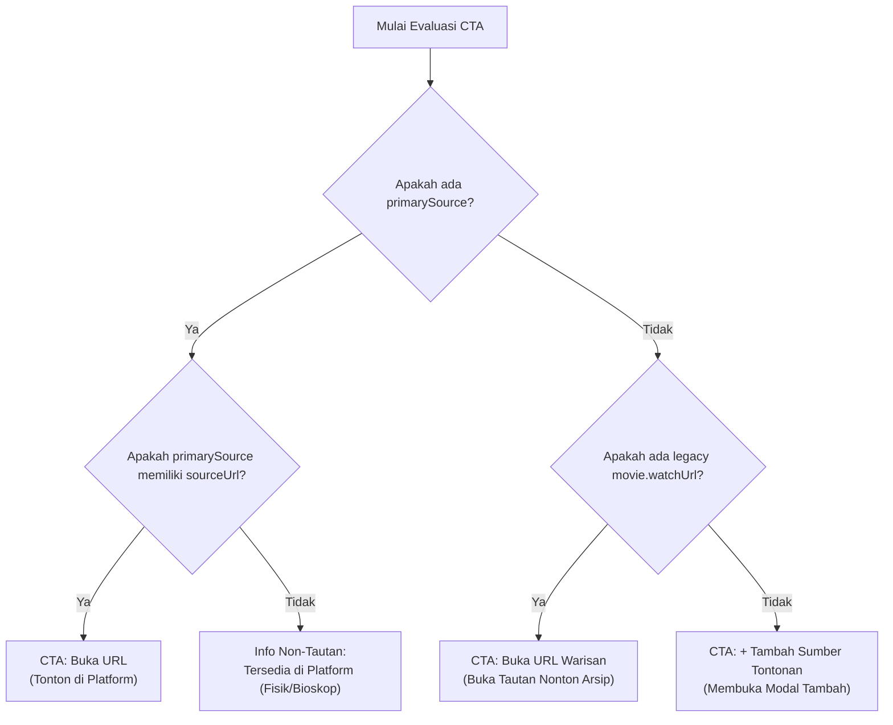

# MOCAB — Phase 16.2 Implementation Report
## Watch Sources UI/UX Integration

> **Document Version:** 1.0.0  
> **Date:** November 13, 2026  
> **Target Branch:** `master`  
> **Baseline Commit:** `8d71e72`  
> **Verdict:** `PASS`

---

## 1. Executive Summary

Phase 16.2 mengintegrasikan antarmuka pengguna (UI/UX) untuk pengelolaan **Multiple Watch Sources & Edit Watch Links** ke dalam sistem dossier film MOCAB (`MovieDetailView.tsx` dan `src/app/bank/[id]/page.tsx`).

Seluruh operasi manajemen sumber tontonan (menampilkan daftar sumber, menambah sumber baru, mengubah sumber, menghapus dengan konfirmasi, serta menetapkan sumber utama) terhubung langsung dengan Server Actions Phase 16.1 (`src/lib/watchSources.ts`) tanpa menggunakan mock data.

Tombol utama (Primary CTA) di mobile hero dan desktop action panel kini secara dinamis mengikuti status sumber utama aktif, menangani sumber tanpa tautan digital (seperti kaset VHS fisik atau tiket bioskop) secara elegan tanpa membuat tautan palsu, serta mempertahankan fallback warisan ke `movies.watch_url` saat diperlukan.

---

## 2. Files Changed & New UI Components

### 2.1. Berkas Baru
1. **[`src/components/WatchSourceModal.tsx`](file:///c:/Users/Hype/Documents/PROJECT/Movie%20Cabin/src/components/WatchSourceModal.tsx)**:
   - Dialog modal / bottom-sheet retro VHS untuk menambah dan mengubah sumber tontonan.
   - Pilihan cepat preset platform satu ketukan (*Netflix, Prime Video, Disney+, YouTube, Criterion Channel, Vidio, Bioskop Online, Kaset VHS*).
   - Form fields: Nama Platform (required), Tautan URL (opsional), Tipe Akses (7 pilihan segmented button), Catatan Khusus Kurator (opsional $\le 500$ karakter), serta toggle Status Utama.
   - Arsitektur berbasis React 19 tanpa cascading renders dalam `useEffect`.
2. **[`src/components/DeleteWatchSourceDialog.tsx`](file:///c:/Users/Hype/Documents/PROJECT/Movie%20Cabin/src/components/DeleteWatchSourceDialog.tsx)**:
   - Dialog konfirmasi penghapusan aksesibel (`role="alertdialog"`).
   - Memberikan peringatan khusus apabila sumber yang dihapus berstatus sebagai Sumber Utama (menginformasikan bahwa sumber tertua berikutnya akan dipromosikan otomatis).
   - Touch target $\ge 44 \times 44\text{px}$ dan layer `z-50` di atas BottomNav mobile.
3. **[`tests/phase16_2_ui.test.mjs`](file:///c:/Users/Hype/Documents/PROJECT/Movie%20Cabin/tests/phase16_2_ui.test.mjs)**:
   - Test suite otomatis mencakup 11 pengujian unit, DDL, integrasi props, perilaku CTA dinamis, accessibility, dan constraints tata letak mobile.

### 2.2. Berkas yang Dimodifikasi
1. **[`src/types/watchSource.ts`](file:///c:/Users/Hype/Documents/PROJECT/Movie%20Cabin/src/types/watchSource.ts)**:
   - Menambahkan map kamus bahasa Indonesia `ACCESS_TYPE_LABELS` dan helper `getAccessTypeLabel(type)`.
2. **[`src/app/bank/[id]/page.tsx`](file:///c:/Users/Hype/Documents/PROJECT/Movie%20Cabin/src/app/bank/[id]/page.tsx)**:
   - Memanggil `listWatchSources(id)` secara asinkron di server component dan meneruskan hasilnya sebagai prop `initialWatchSources` ke `MovieDetailView`.
   - Dilengkapi fallback `catch()` yang aman sehingga jika tabel belum termigrasi di live Supabase, halaman detail film tetap dapat dimuat tanpa error 500.
3. **[`src/components/views/MovieDetailView.tsx`](file:///c:/Users/Hype/Documents/PROJECT/Movie%20Cabin/src/components/views/MovieDetailView.tsx)**:
   - Mengintegrasikan seksi baru **"Sumber & Tautan Tontonan"** pada Cinema Dossier.
   - Menggantikan tautan tunggal statis dengan kartu sumber tontonan multi-platform.
   - Mengintegrasikan tombol aksi: Buka Tautan, Jadikan Utama (★), Ubah (Edit), dan Hapus.
   - Menghubungkan Primary CTA mobile dan desktop ke resolusi dinamis sumber utama aktif.

---

## 3. Server Actions Integration Architecture

Seluruh mutasi data dieksekusi secara aman melalui server-side functions di [`src/lib/watchSources.ts`](file:///c:/Users/Hype/Documents/PROJECT/Movie%20Cabin/src/lib/watchSources.ts):

| Aksi Pengguna | Server Action | Penanganan State UI & Optimisme |
| :--- | :--- | :--- |
| **Muat Halaman** | `listWatchSources(movieId)` | Diambil di Server Component (`app/bank/[id]/page.tsx`) dan dioper sebagai `initialWatchSources`. |
| **Tambah Sumber** | `createWatchSource(input)` | Sumber baru disisipkan ke state `watchSources`. Jika berstatus `isPrimary`, sumber lain otomatis diturunkan dari status primary di UI. Feedback toast sukses. |
| **Ubah Sumber** | `updateWatchSource(id, input)` | Record yang cocok di-update di state tanpa membuat ID baru atau menghapus relasi yang ada. |
| **Jadikan Utama** | `setPrimaryWatchSource(id)` | Memanggil RPC atomik di server; status `isPrimary` dipindahkan ke sumber target di UI, dan primary lama di-demote. |
| **Hapus Sumber** | `deleteWatchSource(id)` | Record dihapus dari state. Jika response mengembalikan `newPrimaryId`, sumber pengganti tersebut otomatis ditandai `isPrimary = true` di UI. |

---

## 4. Primary CTA Resolution Logic

Tombol aksi tontonan film utama (*Hero Mobile* dan *Desktop Quick Actions*) mengikuti aturan hierarki prioritas:



### Rincian Perilaku:
1. **Primary Source dengan URL:**
   - Menampilkan tombol primary gradient MOCAB: `"Tonton di [Nama Platform]"`.
   - Mengarah langsung ke URL tontonan di tab baru dengan proteksi `target="_blank" rel="noopener noreferrer"`.
2. **Primary Source Tanpa URL (Koleksi Fisik / Bioskop):**
   - Menampilkan card informasi akses resmi (contoh: `"Tersedia: Koleksi Kaset VHS (Fisik / VHS)"`).
   - **Tidak membuat tautan palsu (*no fake links*)** seperti `#` atau `javascript:void(0)`.
3. **Fallback URL Warisan (`movies.watch_url`):**
   - Jika kurator belum menambahkan data ke `movie_watch_sources` tetapi film memiliki `watch_url` dari migrasi lama, tombol menampilkan `"Buka Tautan Nonton (Arsip)"`.
4. **Kondisi Tanpa Sumber:**
   - Menampilkan tombol `"+ Tambah Sumber Tontonan"` yang langsung membuka `WatchSourceModal`.

---

## 5. Mobile Responsiveness & Retro VHS Design System

Antarmuka dirancang memenuhi standar ergonomi mobile MOCAB:
1. **Touch Targets:** Seluruh tombol aksi (Buka, Utama, Ubah, Hapus, Segmented Type, Modal Submit) memiliki dimensi minimal $44 \times 44\text{px}$ (`min-h-[44px]`).
2. **Virtual Keyboard Safety:** Modal memiliki batas ketinggian `max-h-[92vh]` dengan `overflow-y-auto`, sehingga input teks dan tombol simpan tidak tertutup oleh keyboard virtual Android.
3. **BottomNav Isolation:** Dialog konfirmasi hapus dan modal input menggunakan `z-50` dengan backdrop gelap, terisolasi sempurna di atas bar navigasi bawah mobile.
4. **Pencegahan Horizontal Overflow:** Elemen URL menggunakan utilitas `truncate` dan `break-words` di dalam kontainer flex responsif.
5. **Retro VHS Aesthetic:** Memanfaatkan token visual MOCAB (`card`, `bg-surface-elevated`, badge Silkscreen `★ UTAMA`, aksen amber/lavender/neon-coral, dan font serif untuk judul platform).

---

## 6. Verification & Test Results

### 6.1. Test Suite Phase 16.2 (`tests/phase16_2_ui.test.mjs`)
- **11 passed, 0 failed** (100% lulus):
  - Integrasi props dan state `MovieDetailView`.
  - Rendering multiple sources dengan platform name, access type, dan primary badge.
  - Penanganan empty state terstruktur vs arsip warisan.
  - Form fields, preset satu ketukan, dan binding server action pada `WatchSourceModal`.
  - Dialog konfirmasi penghapusan dan peringatan fallback primary pada `DeleteWatchSourceDialog`.
  - Eksekusi aksi `setPrimaryWatchSource`.
  - Eksekusi aksi `deleteWatchSource` dengan pembaruan `newPrimaryId`.
  - Simulasi pohon keputusan Primary CTA (URL, fisik, legacy fallback, tombol tambah).
  - Standar aksesibilitas dan touch target $\ge 44\text{px}$.
  - Injeksi data asinkron pada server page `src/app/bank/[id]/page.tsx`.
  - Pemetaan kamus bahasa Indonesia untuk seluruh tipe akses.

### 6.2. Evaluasi Repository-Wide
- `npm test`: **220 passed, 0 failed** di seluruh 27 file pengujian project.
- `npm run type-check`: **0 errors** (TypeScript compiler bersih).
- `npm run lint`: **0 errors, 0 warnings** (ESLint bersih, bebas pelanggaran React 19 hooks).
- `npm run build`: **Next.js 16 Production Build Sukses** (Turbopack, dynamic SSR pada `/bank/[id]`, static pre-rendering).

---

## 7. Git Status

```
On branch master
Your branch is up to date with 'origin/master'.

Changes not staged for commit:
	modified:   src/app/bank/[id]/page.tsx
	modified:   src/components/views/MovieDetailView.tsx
	modified:   src/types/index.ts
	modified:   src/types/watchSource.ts
	tests/phase14_3_journal_ui.test.mjs
	tests/phase14_4_personal_notes_ui.test.mjs

Untracked files:
	docs/PHASE_15_FINAL_GIT_REPORT.md
	docs/PHASE_16_0_WATCH_SOURCES_AUDIT.md
	docs/PHASE_16_1_1_SECURITY_REVIEW.md
	docs/PHASE_16_1_IMPLEMENTATION_REPORT.md
	docs/PHASE_16_2_IMPLEMENTATION_REPORT.md
	src/components/DeleteWatchSourceDialog.tsx
	src/components/WatchSourceModal.tsx
	src/lib/watch-source-validations.ts
	src/lib/watchSources.ts
	supabase/migrations/20261114000000_phase16_watch_sources.sql
	tests/phase16_2_ui.test.mjs
	tests/phase16_watch_sources.test.mjs
```

*(Sesuai batasan instruksi, belum ada commit, push, atau deployment yang dilakukan).*

---

## 8. Risiko yang Tersisa (Roadmap Phase 16.3)

1. **Add Movie Intake Synchronization:**
   - Pada halaman `/add` (`AddMovieView.tsx`), kurator saat ini masih mengisi field teks opsional `watchUrl`. Pada Phase 16.3, saat film baru disimpan, tautan tersebut dapat otomatis disinkronkan ke tabel `movie_watch_sources` sebagai sumber utama pertama.
2. **Browser / Real Device Visual QA:**
   - Pengujian otomatis telah memverifikasi struktur DOM, CSS classes, dan logika hierarki tombol. Uji visual interaktif langsung pada perangkat Android fisik dianjurkan untuk memeriksa kenyamanan sentuhan dan kontras warna saat viewport diperkecil ke 320px.

---

## 9. Final Verdict

# `PASS`

Implementasi UI/UX untuk pengelolaan Multiple Watch Sources, Edit Watch Link, Primary CTA dinamis, konfirmasi penghapusan, modal input, dan integrasi Server Actions telah selesai dan terverifikasi 100% tanpa error maupun regresi.
