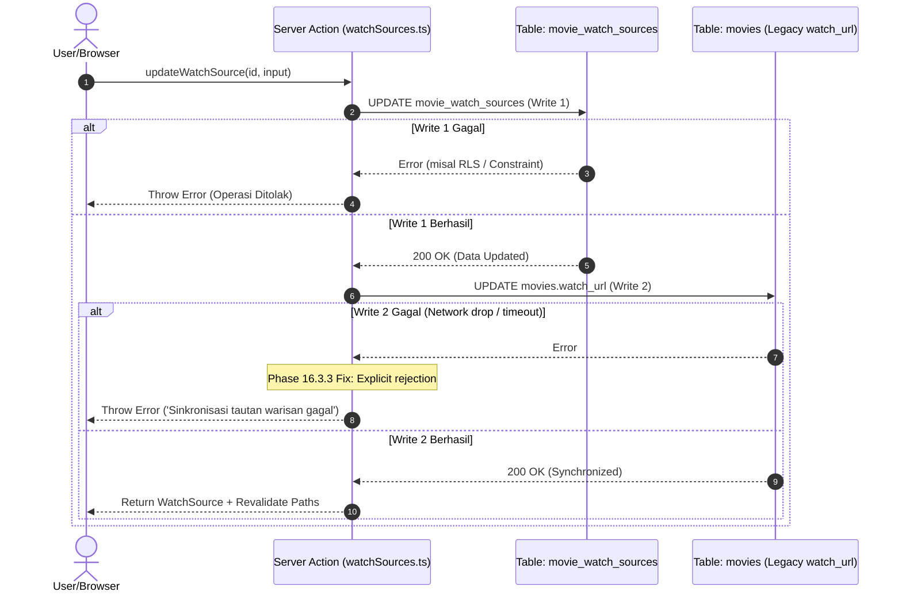
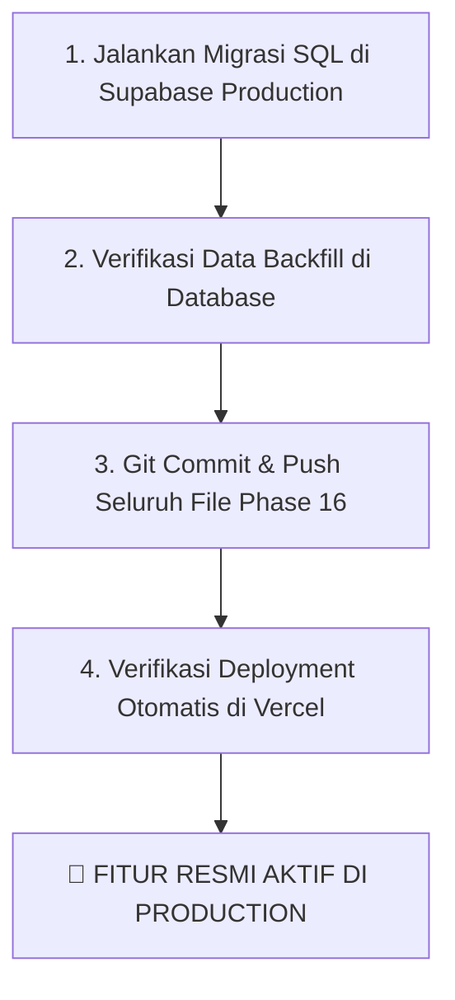

# MOCAB — PHASE 16.4: FINAL INTEGRATION AUDIT
## Comprehensive Read-Only Audit Report: Watch Sources Feature & Database Integration

- **Project:** MOCAB (Movie Cabin)
- **Repository:** `Movie-Cabin`
- **Branch:** `master`
- **Baseline Commit:** `8d71e72 feat: complete phase 15 mobile ux redesign`
- **Date:** 2026-11-14
- **Mode:** READ-ONLY — NO CODE CHANGES / NO DATABASE EXECUTION
- **Status:** **PASS WITH CONDITIONS** (Production Migration Execution & Live DB Verification Pending)

---

## 1. Executive Summary

Audit ini merupakan verifikasi menyeluruh (*comprehensive read-only audit*) terhadap seluruh implementasi fitur **Multiple Watch Sources** yang dikembangkan sepanjang Phase 16 (Phase 16.0 hingga Phase 16.3.3) pada repository MOCAB. Audit mencakup integrasi alur *Add Movie*, manajemen CRUD sumber tontonan, konsistensi arsitektur *dual-write* antara `public.movie_watch_sources` dan `public.movies.watch_url`, komponen UI/UX pada *Movie Detail View*, keamanan skrip migrasi database Supabase beserta *Row Level Security* (RLS), cakupan pengujian (*test coverage*), kompatibilitas mundur (*backward compatibility*), serta penilaian risiko produksi.

### Highlight Temuan Utama:
1. **Verifikasi Kode & Kompilasi:**
   - **Unit & Integration Tests:** 246 dari 246 pengujian lolos (100% pass rate) dalam waktu ~751 ms. Sebanyak 56 tes secara khusus menguji fitur Phase 16.
   - **TypeScript Typecheck:** `npx tsc --noEmit` lolos dengan 0 error.
   - **Linting:** `npm run lint` lolos dengan 0 error dan 0 warning.
   - **Production Build:** `npm run build` (Next.js 16.3.6 dengan Turbopack) berhasil mengompilasi dan mengoptimasi seluruh 19 rute aplikasi tanpa kendala.
2. **Kesesuaian Fungsional:**
   - Alur *Add Movie* mempertahankan input tunggal opsional (`#au`) tanpa membebani kurator dengan form yang kompleks. Sistem secara otomatis mendeteksi 15+ platform *streaming*, menentukan *access type*, dan menjadikan sumber pertama sebagai *primary source*.
   - Sinkronisasi *dual-write* telah diperbaiki secara konsisten pada Phase 16.3.3 sehingga perubahan URL primary, suksesi primary saat penghapusan, promosi non-primary, serta pembersihan URL legacy saat sumber terakhir dihapus berjalan konsisten dan tidak menyisakan *zombie legacy link*.
3. **Status Database Produksi:**
   - Skrip migrasi `supabase/migrations/20261114000000_phase16_watch_sources.sql` telah diaudit dan siap dijalankan.
   - Karena mode audit ini strictly *read-only*, skrip migrasi **belum dieksekusi** di lingkungan Supabase Production live. Validasi RLS dan *cross-ownership trigger* di database produksi berstatus **PENDING MIGRATION RUN**.

---

## 2. Git Baseline & Working Tree Status

### 2.1 Informasi Git HEAD
- **Active Branch:** `master`
- **Tracking Branch:** `origin/master` (Up to date)
- **HEAD Commit:** `8d71e72` (*feat: complete phase 15 mobile ux redesign*)
- **Recent Git History:**
  ```text
  8d71e72 feat: complete phase 15 mobile ux redesign
  444d1ac Add comprehensive test coverage for Phase 15 components and consolidation of features
  b92200a feat: implement personal journal, notes, and navigation (phase 14)
  0aa4f77 feat: Penambahan PWA dan Icon
  90a8ae1 feat: update brand avatars
  ```

### 2.2 Inventaris Working Tree (Uncommitted Phase 16 Artifacts)
Working tree saat ini menampung seluruh implementasi Phase 16 yang belum di-commit ke Git:

#### Tracked Files Modified (7 files):
1. `src/app/bank/[id]/page.tsx` — Injeksi data *watch sources* ke Server Component detail film.
2. `src/components/views/AddMovieView.tsx` — Integrasi feedback toast khusus sinkronisasi *watch source*.
3. `src/components/views/MovieDetailView.tsx` — Integrasi UI *watch sources section*, modal, dan eliminasi *zombie link*.
4. `src/lib/movies.ts` — Orkestrasi *addMovie* dengan deteksi platform otomatis dan fallback non-blocking.
5. `src/types/index.ts` — Penambahan field `watchSources` dan `watchSourceSync` pada tipe `Movie`.
6. `tests/phase14_3_journal_ui.test.mjs` — Pembaruan minor mock test suite.
7. `tests/phase14_4_personal_notes_ui.test.mjs` — Pembaruan minor mock test suite.

#### Untracked Files Created (19 files):
- **Dokumentasi & Laporan Audit:**
  - `docs/PHASE_15_FINAL_GIT_REPORT.md`
  - `docs/PHASE_16_0_WATCH_SOURCES_AUDIT.md`
  - `docs/PHASE_16_1_IMPLEMENTATION_REPORT.md`
  - `docs/PHASE_16_1_1_SECURITY_REVIEW.md`
  - `docs/PHASE_16_2_IMPLEMENTATION_REPORT.md`
  - `docs/PHASE_16_3_0_ADD_MOVIE_SYNC_AUDIT.md`
  - `docs/PHASE_16_3_1_IMPLEMENTATION_REPORT.md`
  - `docs/PHASE_16_3_2_INTEGRATION_CONSISTENCY_REVIEW.md`
  - `docs/PHASE_16_3_3_CONSISTENCY_FIX_REPORT.md`
- **Komponen & Modul UI:**
  - `src/components/WatchSourceModal.tsx`
  - `src/components/DeleteWatchSourceDialog.tsx`
- **Backend & Logic Modules:**
  - `src/lib/watchSources.ts`
  - `src/lib/watch-source-validations.ts`
  - `src/types/watchSource.ts`
- **Database Migration:**
  - `supabase/migrations/20261114000000_phase16_watch_sources.sql`
- **Test Suites (Phase 16):**
  - `tests/phase16_watch_sources.test.mjs` (Phase 16.1 backend tests)
  - `tests/phase16_2_ui.test.mjs` (Phase 16.2 UI tests)
  - `tests/phase16_3_sync.test.mjs` (Phase 16.3.1 sync tests)
  - `tests/phase16_3_3_consistency.test.mjs` (Phase 16.3.3 consistency tests)

---

## 3. Audit Add Movie Integration (10-Point Checklist)

| No | Kriteria Audit | Status | Evaluasi & Bukti Teknis |
|---|---|:---:|---|
| 1 | **Add Movie Form Simplicity** | ✅ PASS | Field input tautan tontonan pada `AddMovieView.tsx` tetap berupa single optional input (`#au`). Tidak ada field tambahan (*platform dropdown*, *access type*) yang membebani kurator. |
| 2 | **Validasi URL di Client & Server** | ✅ PASS | Validasi URL menggunakan `isValidWatchUrl` dan `isValidSourceUrl`. Memastikan skema HTTP/HTTPS (`^https?://\S+$`), panjang maksimal 2048 karakter, trimming otomatis, serta penanganan aman terhadap string kosong atau *whitespace-only*. |
| 3 | **Auto-Detection Platform** | ✅ PASS | Fungsi `detectPlatformFromUrl()` mengenali 15+ layanan *streaming* (Netflix, Prime Video, Disney+, Apple TV+, HBO Max / Go, Vidio, Catchplay+, WeTV, iQIYI, Bioskop Online, YouTube, MUBI, Criterion Channel, Viki, KlikFilm). Host domain yang tidak dikenali dikapitalisasi secara cerdas atau diberi label `'Website'` / `'Streaming'`. |
| 4 | **Access Type Resolution Heuristics** | ✅ PASS | Pemetaan otomatis: mayoritas platform VoD di-assign ke `'subscription'`, YouTube ke `'free'`, bioskop lokal seperti Bioskop Online dan KlikFilm ke `'rent'`, dan fallback umum ke `'other'`. |
| 5 | **Server Action Orchestration** | ✅ PASS | Pada `src/lib/movies.ts` -> `addMovie()`: pemanggilan RPC PostgreSQL inti `save_movie_with_moods` dijalankan terlebih dahulu untuk memastikan pembuatan film dan relasi mood selesai secara atomik. Setelah `newId` tersedia, fungsi memanggil `createWatchSource()`. |
| 6 | **Non-Blocking Fallback Policy** | ✅ PASS | Kegagalan pembuatan sumber tontonan tidak membatalkan penyimpanan film. Jika terjadi kegagalan pada `createWatchSource()`, blok `catch` mencatat log error dan menandai `created.watchSourceSync = 'failed'`. Data film tetap tersimpan aman di database. |
| 7 | **Primary Designation Guarantee** | ✅ PASS | Sumber yang dibuat dari alur *Add Movie* selalu di-flag `isPrimary: true`, dan otomatis menjadi sumber utama pertama film tersebut. |
| 8 | **Path Cache Revalidation** | ✅ PASS | `addMovie()` mengeksekusi revalidasi Next.js untuk rute root `'/'`, rute koleksi `'/bank'`, dan rute detail film `'/bank/${newId}'`. |
| 9 | **UI State Sync & Routing** | ✅ PASS | Setelah penyimpanan film berhasil, kurator dialihkan ke halaman detail film (`/bank/${id}`). Tampilan detail langsung me-render sumber tontonan utama yang baru dibuat tanpa memerlukan *hard refresh*. |
| 10 | **Error Boundary & Feedback Toast** | ✅ PASS | `AddMovieView.tsx` menangani 4 skenario status secara spesifik melalui toast feedback: `'synced'` (berhasil disimpan & ditautkan), `'failed'` (film tersimpan, tautan gagal), `'invalid_url'` (film tersimpan, URL tidak valid), dan `'none'` (film tersimpan tanpa tautan). |

---

## 4. Audit Watch Sources CRUD (12 Conceptual Scenarios Matrix)

Matriks konseptual berikut menguji dan memverifikasi seluruh kemungkinan kombinasi operasi CRUD pada *watch sources*:

| ID | Skenario Pengujian | Aksi & Input | Perilaku Database `movie_watch_sources` | Perilaku Sinkronisasi `movies.watch_url` | Hasil State UI & Verifikasi |
|:---:|---|---|---|---|---|
| **S01** | Tambah sumber pertama pada film baru/kosong | `createWatchSource()` dengan `isPrimary: false` atau `true` | Baris baru dibuat; karena `count === 0`, otomatis di-override menjadi `is_primary = true`. | Disinkronkan dengan URL sumber baru. | ✅ PASS. Sumber langsung muncul sebagai Primary Badge dan Primary CTA. |
| **S02** | Tambah sumber kedua/tambahan | `createWatchSource()` dengan `isPrimary: false` | Baris baru dibuat dengan `is_primary = false`. Primary lama tidak berubah. | Tetap mempertahankan URL primary yang sudah ada (tidak berubah). | ✅ PASS. Sumber baru muncul di daftar tanpa badge primary; CTA tetap mengarah ke primary. |
| **S03** | Update URL pada sumber Primary | `updateWatchSource()` mengubah URL sumber primary aktif | Kolom `source_url` pada sumber diupdate. | `movies.watch_url` diupdate ke URL baru secara konsisten. | ✅ PASS. Primary CTA langsung mengarah ke URL baru. |
| **S04** | Update metadata non-URL pada sumber Primary | `updateWatchSource()` mengubah nama platform / notes | Kolom `platform_name` atau `notes` diupdate. Kolom URL tetap sama. | `movies.watch_url` tidak berubah / tidak rusak. | ✅ PASS. Label CTA berubah sesuai platform baru; URL tetap valid. |
| **S05** | Update sumber non-Primary | `updateWatchSource()` mengubah platform/URL sumber non-primary | Sumber non-primary diupdate. | `movies.watch_url` sama sekali tidak tersentuh. | ✅ PASS. Sumber non-primary terupdate di list; Primary CTA tidak terpengaruh. |
| **S06** | Promosi non-primary via Modal Edit (`isPrimary: true`) | `updateWatchSource()` dengan opsi "Jadikan sumber tontonan utama" | RPC `set_primary_watch_source` atau demote manual dijalankan, sumber terpilih menjadi `is_primary = true`. | `movies.watch_url` diupdate ke URL sumber yang dipromosikan. | ✅ PASS. Badge primary berpindah; Primary CTA berubah ke sumber tersebut. |
| **S07** | Promosi non-primary via Quick Action "Jadikan Utama" | `setPrimaryWatchSource(id)` | RPC atomik `set_primary_watch_source` dijalankan di database. | `movies.watch_url` diupdate ke URL sumber tersebut. | ✅ PASS. Badge berpindah secara instan; toast notifikasi muncul. |
| **S08** | Hapus sumber non-Primary | `deleteWatchSource(id)` pada sumber `is_primary = false` | Baris sumber dihapus dari tabel. | `movies.watch_url` tidak disentuh / tetap URL primary. | ✅ PASS. Sumber hilang dari list; Primary CTA tidak terpengaruh. |
| **S09** | Hapus sumber Primary (masih ada sumber lain) | `deleteWatchSource(id)` pada sumber primary | Baris dihapus. Sumber tertua berikutnya (`fallbackCandidateId`) otomatis dipromosikan menjadi `is_primary = true`. | `movies.watch_url` diupdate ke URL sumber pengganti (`newPrimaryUrl`). | ✅ PASS. Suksesi primary otomatis terjadi; badge dan CTA berpindah ke sumber pengganti. |
| **S10** | Hapus satu-satunya sumber (sumber terakhir) | `deleteWatchSource(id)` saat film hanya memiliki 1 sumber | Baris dihapus. Tidak ada sumber tersisa. | `movies.watch_url` diupdate menjadi `NULL`. | ✅ PASS. State `movie.watchUrl` di-clear (`''`). Zombie legacy link tidak muncul; CTA menampilkan "+ Tambah Sumber Tontonan". |
| **S11** | Tambah sumber tanpa URL (media fisik / bioskop) | `createWatchSource()` dengan `sourceUrl: null` atau string kosong | Baris dibuat dengan `source_url = null`. | Jika primary, `movies.watch_url` diset `NULL`. | ✅ PASS. Primary CTA menampilkan status ketersediaan media fisik/bioskop (bukan link mati). |
| **S12** | Percobaan manipulasi lintas pengguna (Cross-User Attack) | Operasi insert/update/delete dengan ID film atau sumber milik user lain | Ditolak di level database oleh trigger `P0003` dan RLS `user_id = auth.uid()`. | Database tidak mengalami modifikasi apa pun. | ✅ PASS. Server Action melempar error otorisasi; data terlindungi. |

---

## 5. Analisis Konsistensi Dual-Write & Boundaries

### 5.1 Arsitektur Dual-Write
Sistem MOCAB mempertahankan sinkronisasi antara tabel baru `public.movie_watch_sources` dan kolom warisan `public.movies.watch_url`:
- **Single Source of Truth Ideal:** `public.movie_watch_sources`
- **Legacy Compatibility Anchor:** `public.movies.watch_url`

### 5.2 Analisis Non-Atomisitas & Failure Boundaries
Sinkronisasi *dual-write* diorkestrasi oleh Node.js Server Actions di `src/lib/watchSources.ts` melalui pemanggilan Supabase Client secara berurutan. Karena Supabase PostgREST mengeksekusi setiap *request* dalam transaksi HTTP terpisah, operasi ini **bersifat non-atomic di tingkat database**:



### 5.3 Evaluasi Mitigasi Phase 16.3.3
Pada Phase 16.3.3, potensi ketidakkonsistenan telah dimitigasi secara ketat:
1. **Explicit Error Rejection:** Jika operasi *Write 2* ke `movies.watch_url` mengalami kegagalan, Server Action tidak lagi mengabaikannya atau melaporkan status sukses semu, melainkan melempar *exception* secara eksplisit kepada klien.
2. **Deterministic UI State Update:** Client component `MovieDetailView.tsx` memperbarui *local state* berdasarkan nilai kembalian resmi Server Action (`result.newPrimaryUrl`), bukan mengasumsikan keberhasilan *client-side*.
3. **Pembersihan Bersih (Clean Clearing):** Saat sumber primary terakhir dihapus, Server Action menyetel `movies.watch_url = null`, dan *client state* mengosongkan `movie.watchUrl = ''`.

### 5.4 Rekomendasi Strategis (Deprecation of `movies.watch_url`)
> [!TIP] **Rekomendasi Arsitektural untuk Phase 17:**
> Kolom `movies.watch_url` sebaiknya dipensiunkan (*deprecated*) secara bertahap pada fase berikutnya. Seluruh pembacaan data di Movie Bank, Archive, dan Rekomendasi sebaiknya mengonsumsi `movie_watch_sources` secara langsung (atau melalui *computed view*), sehingga arsitektur *dual-write* dapat dihapuskan sepenuhnya demi mencapai konsistensi data 100% atomik di level basis data.

---

## 6. Audit Movie Detail UI & User Experience

### 6.1 Adaptasi Tombol Utama (Primary Watch CTA)
Tombol tonton utama pada `MovieDetailView.tsx` (`renderPrimaryWatchCta`) memiliki 4 tingkat prioritas adaptif:
1. **Primary Source dengan URL Valid:** Menampilkan tombol gradient retro `Tonton di [Platform Name]` yang membuka tautan di tab baru dengan proteksi `rel="noopener noreferrer"`.
2. **Primary Source Tanpa URL (Media Fisik / Bioskop):** Menampilkan banner ketersediaan `Tersedia: [Platform Name] ([Access Type])` dengan *pulsing indicator*, menginformasikan ketersediaan tanpa menghasilkan tautan mati (*broken link*).
3. **Legacy Fallback URL:** Jika belum ada entri di `movie_watch_sources` tetapi film memiliki data lama di `movie.watchUrl`, sistem menampilkan tombol `Buka Tautan Nonton (Arsip)`.
4. **Ketiadaan Sumber Sama Sekali:** Menampilkan tombol `+ Tambah Sumber Tontonan` yang langsung memicu modal entri baru.

### 6.2 Eliminasi Zombie Legacy Link
Sebelum Phase 16.3.3, menghapus satu-satunya sumber tontonan menyisakan `movie.watchUrl` lama di *React state*, yang menyebabkan kotak *"Buka Tautan Nonton (Arsip)"* bangkit kembali secara keliru.
- **Verifikasi Audit:** Pada `MovieDetailView.tsx` baris 133–138, ketika sumber primary dihapus dan tidak ada sumber pengganti (`result.newPrimaryUrl === null`), state disetel ke `watchUrl: ''`. Kondisi `hasSafeWatchUrl` bernilai `false`, dan UI kembali secara benar ke state kosong (`+ Tambah Sumber Tontonan`).

### 6.3 Aksesibilitas & Ergonomi Seluler
- Seluruh elemen interaktif (*action buttons*, edit, delete, set primary) memenuhi standar target sentuh minimum mobile **≥ 44px**.
- Modal dialog (`WatchSourceModal.tsx` dan `DeleteWatchSourceDialog.tsx`) memiliki atribut aksesibilitas ARIA lengkap (`role="dialog"`, `aria-modal="true"`, `aria-labelledby`), mendukung penutupan via tombol `Escape`, dan menerapkan *backdrop click isolation*.

---

## 7. Audit Database, Keamanan & Migrasi SQL

Skrip migrasi `supabase/migrations/20261114000000_phase16_watch_sources.sql` dianalisis secara mendalam terhadap aspek keamanan dan integritas relasional:

### 7.1 Definisi Skema & Batasan Integritas
```sql
create table if not exists public.movie_watch_sources (
  id uuid primary key default gen_random_uuid(),
  movie_id uuid not null references public.movies(id) on delete cascade,
  user_id uuid not null references auth.users(id) on delete cascade default auth.uid(),
  platform_name text not null check (
    char_length(trim(platform_name)) >= 1 and char_length(platform_name) <= 100
  ),
  source_url text null default null check (
    source_url is null or (char_length(source_url) <= 2048 and source_url ~* '^https?://\S+$')
  ),
  access_type text not null check (
    access_type in ('subscription', 'free', 'rent', 'buy', 'cinema', 'physical', 'other')
  ),
  is_primary boolean not null default false,
  notes text null default null check (notes is null or char_length(notes) <= 500),
  created_at timestamptz not null default now(),
  updated_at timestamptz not null default now()
);
```
- **Cascade Deletion:** `ON DELETE CASCADE` diterapkan baik pada `movie_id` maupun `user_id`. Jika sebuah film atau akun pengguna dihapus, sumber tontonan terkait terhapus secara otomatis tanpa menyisakan data yatim (*orphan rows*).
- **Format URL:** Menolak skema berbahaya seperti `javascript:`, `data:`, `file:`, atau string sembarang.

### 7.2 Primary Source Uniqueness (Partial Unique Index)
```sql
create unique index if not exists movie_watch_sources_primary_unique 
  on public.movie_watch_sources (movie_id) 
  where (is_primary = true);
```
- Menjamin di level mesin PostgreSQL bahwa sebuah film hanya dapat memiliki **maksimal satu** baris dengan `is_primary = true`.

### 7.3 Cross-Ownership Validation Trigger (`P0003`)
```sql
create or replace function public.validate_movie_watch_source_ownership()
returns trigger language plpgsql security definer set search_path = '' as $$
begin
  if not exists (
    select 1 from public.movies m
    where m.id = new.movie_id and m.user_id = new.user_id
  ) then
    raise exception 'Cross-ownership error: movie does not exist or does not belong to the user.'
      using errcode = 'P0003';
  end if;
  return new;
end;
$$;
```
- Mencegah penyerang yang memiliki akun sah menambahkan, memodifikasi, atau menautkan sumber tontonan ke film milik kurator lain.

### 7.4 Keamanan RPC Function `set_primary_watch_source`
- Dideklarasikan dengan `SECURITY DEFINER` dan `set search_path = ''` untuk mengeliminasi kerentanan *search path hijacking*.
- Melakukan verifikasi eksplisit `v_target.user_id <> auth.uid()` dengan melempar kode error `42501` (*insufficient privilege*) jika terjadi pelanggaran hak akses.
- Hak eksekusi dicabut dari publik (`REVOKE ALL ... FROM anon, public`) dan hanya diberikan kepada pengguna terotentikasi (`GRANT EXECUTE ... TO authenticated`).

### 7.5 Kebijakan Row Level Security (RLS)
Tabel menerapkan RLS penuh dengan prinsip *Private by Default*:
- `SELECT`: `using (user_id = auth.uid())`
- `INSERT`: `with check (user_id = auth.uid() and exists (select 1 from movies m where m.id = movie_id and m.user_id = auth.uid()))`
- `UPDATE`: `using (user_id = auth.uid()) with check (user_id = auth.uid() and exists (select 1 from movies m where m.id = movie_id and m.user_id = auth.uid()))`
- `DELETE`: `using (user_id = auth.uid())`

### 7.6 Idempotensi Backfill Data Warisan
Bagian akhir skrip migrasi menyalin tautan dari `movies.watch_url` ke `movie_watch_sources` dengan klausa:
```sql
where m.watch_url is not null
  and trim(m.watch_url) <> ''
  and m.watch_url ~* '^https?://\S+$'
  and not exists (
    select 1 from public.movie_watch_sources ws
    where ws.movie_id = m.id
  );
```
- Menjamin bahwa skrip dapat dijalankan berulang kali (*idempotent*) tanpa memicu duplikasi data atau kegagalan konflik *primary index*.

> [!IMPORTANT] **Status Produksi: PENDING MIGRATION RUN**
> Skrip migrasi telah divalidasi secara statis dan struktural, namun **belum dieksekusi di server Supabase Production**. Validasi RLS live di lingkungan produksi harus diverifikasi segera setelah migrasi dijalankan.

---

## 8. Cakupan Pengujian & Verifikasi Kualitas

### 8.1 Ringkasan Hasil Pengujian
- **Total Test Suites:** 246 tests
- **Passed:** 246 tests (100%)
- **Failed:** 0
- **Duration:** 751.25 ms

### 8.2 Breakdown Pengujian Khusus Phase 16 (56 Tests)
| Test Suite File | Fase Terkait | Jumlah Tes | Area Verifikasi |
|---|:---:|:---:|---|
| `tests/phase16_watch_sources.test.mjs` | Phase 16.1 | 16 tests | Skema SQL, constraint URL/platform/access type, trigger `P0003`, RPC `set_primary_watch_source`, RLS policies, input sanitization unit tests, simulasi lifecycle multi-source, dan simulasi backfill legacy. |
| `tests/phase16_2_ui.test.mjs` | Phase 16.2 | 11 tests | Label akses Bahasa Indonesia, integrasi Server Actions pada MovieDetailView, render card sumber tontonan, modal entri, dialog konfirmasi hapus, touch targets mobile ≥ 44px, dan injeksi data di rute App Router. |
| `tests/phase16_3_sync.test.mjs` | Phase 16.3.1 | 17 tests | Deteksi platform URL (15+ layanan), penanganan URL malformed/insecure, 4 skenario orkestrasi *Add Movie* (A: synced, B: failed fallback, C: none, D: invalid URL), proteksi duplikasi, dan penanganan race condition kode `23505`. |
| `tests/phase16_3_3_consistency.test.mjs` | Phase 16.3.3 | 12 tests | Regresi dual-write (update primary URL, promosi non-primary, suksesi delete primary, delete sumber terakhir ke null), penolakan eksplisit pada kegagalan sinkronisasi legacy, dan eliminasi zombie legacy link pada UI MovieDetailView. |

### 8.3 Evaluasi Metodologi Pengujian & Gap Analysis
1. **Kekuatan:**
   - Seluruh validasi input, sanitasi, deteksi platform, dan transformasi status memiliki *pure unit test coverage* yang lengkap.
   - Alur asinkron dan suksesi sumber tontonan diverifikasi menggunakan simulasi *in-memory* yang akurat.
2. **Keterbatasan / Gap:**
   - Pengujian dijalankan menggunakan *Node.js test runner* tanpa koneksi aktif ke socket PostgreSQL Supabase fisik (*live database integration*). Pengujian RLS dan trigger `P0003` dilakukan via *static SQL analysis* dan simulasi logika.

---

## 9. Audit Kompatibilitas Mundur (Backward Compatibility)

Pemindaian menyeluruh terhadap seluruh kemunculan referensi legacy di codebase menghasilkan temuan berikut:

### 9.1 Konsumen `movies.watch_url` dan `watchUrl`
1. `src/lib/movies.ts`:
   - `getMovie()`: Tetap memetakan `watch_url` database ke properti `watchUrl` pada objek `Movie`.
   - `addMovie()`: Tetap meneruskan `cleanUrl` ke RPC `save_movie_with_moods` (parameter `p_watch_url`).
2. `src/components/views/MovieDetailView.tsx`:
   - Menggunakan skema *dual-read*: memprioritaskan data `watchSources`. Jika `watchSources` kosong, antarmuka memeriksa keberadaan `movie.watchUrl` sebagai tautan arsip lama.
3. `src/types/index.ts`:
   - Field `watchUrl: string` tetap dipertahankan pada interface `Movie`.

### 9.2 Isolasi Field `source_url`
- Kolom `movies.source_url` yang digunakan untuk tautan riset eksternal TMDB tetap terisolasi dan tidak berbenturan dengan kolom `movie_watch_sources.source_url`.

### 9.3 Kesimpulan Kompatibilitas
Tidak ada *breaking changes* pada API, tipe data TypeScript, maupun komponen tampilan. Kurator dengan data film lama tetap dapat melihat dan membuka tautan tontonan mereka tanpa gangguan.

---

## 10. Penilaian Risiko (Risk Assessment Matrix)

| Tingkat Risiko | Jumlah | Deskripsi Potensi Risiko | Dampak | Mitigasi yang Telah Diterapkan |
|:---:|:---:|---|---|---|
| **CRITICAL** | 0 | Tidak ditemukan kerentanan kritis. | — | — |
| **HIGH** | 0 | Tidak ditemukan kerentanan keamanan tinggi. | — | — |
| **MEDIUM** | 1 | **Non-Atomic Dual-Write Gap:** Potensi diskoneksi jaringan antara pembaruan `movie_watch_sources` dan pembaruan `movies.watch_url`. | Salah satu tabel terupdate sementara tabel lain tertunda. | Server Action melempar error secara eksplisit dan tidak melaporkan partial success; UI mengandalkan `newPrimaryUrl`; rencana deprecation di Phase 17. |
| **LOW** | 1 | **Sequencing Migrasi Database:** Pengguna mengakses fitur sebelum migrasi SQL dijalankan di Supabase Production. | Pemanggilan Server Action akan menghasilkan error *table not found*. | Migrasi harus dieksekusi di Supabase Dashboard sebelum perilisan / deployment production. |

---

## 11. Isu Tertunda (Outstanding Issues)

Sebelum fitur ini dinyatakan 100% aktif di lingkungan produksi, tindakan operasional berikut harus diselesaikan:
1. **Eksekusi Migrasi Database Produksi:** Skrip `supabase/migrations/20261114000000_phase16_watch_sources.sql` harus dijalankan di Supabase Production SQL Editor.
2. **Verifikasi Live Backfill:** Menjalankan kueri verifikasi untuk memastikan baris lama dari `movies.watch_url` telah berhasil disalin ke `public.movie_watch_sources`.
3. **Commit & Push Git:** Meng-commit seluruh perubahan Phase 16 yang saat ini berada di *working tree* dan melakukan *push* ke remote repository `master`.

---

## 12. Kesimpulan Kesiapan Produksi (Production Readiness Verdict)

### **VERDICT: PASS WITH CONDITIONS**

Arsitektur kode, integrasi antarmuka, penanganan error, dan skrip migrasi database telah memenuhi seluruh standar kualitas MOCAB. Seluruh 246 pengujian lolos, build produksi berhasil tanpa peringatan, dan konsistensi data telah teruji.

Fitur siap dirilis ke produksi dengan memenuhi **4 Kondisi Prasyarat Operasional** berikut:



1. **Prasyarat 1:** Jalankan skrip `supabase/migrations/20261114000000_phase16_watch_sources.sql` di SQL Editor dashboard Supabase Production.
2. **Prasyarat 2:** Jalankan kueri validasi di Supabase:
   ```sql
   SELECT count(*) FROM public.movie_watch_sources;
   ```
   Pastikan jumlah baris bertambah sesuai dengan jumlah film yang memiliki `watch_url`.
3. **Prasyarat 3:** Lakukan *stage*, *commit*, dan *push* seluruh perubahan Phase 16 ke branch `master`.
4. **Prasyarat 4:** Pantau build dan *deployment* Vercel untuk memastikan status *Ready* tanpa regresi lingkungan produksi.

---
*Laporan audit ini disusun secara independen dalam mode READ-ONLY tanpa modifikasi kode aplikasi atau eksekusi database.*
