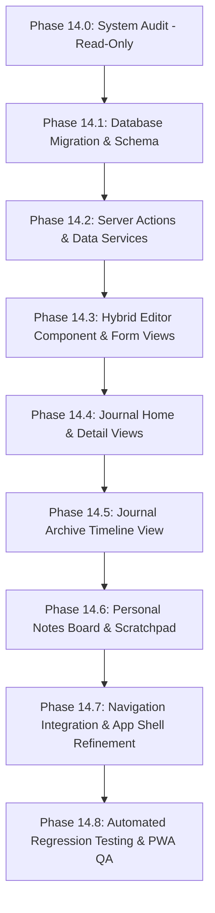

# MOCAB — PHASE 14.0 SYSTEM AUDIT
## DAILY JOURNAL & PERSONAL NOTES ARCHITECTURE

**Project:** Movie Cabin (MOCAB) — Beruang Sastra  
**Branch:** `master`  
**Phase:** 14.0 (Architectural System Audit — Read-Only Mode)  
**Date:** November 2026  
**Status:** COMPLETED (AUDIT ONLY — NO CODE MODIFIED)  

---

## 1. EXECUTIVE SUMMARY

Phase 14.0 initiates the expansion of MOCAB (Movie Cabin) from a cinematic curation archive into a unified creative sanctuary by introducing two foundational personal writing capabilities:

1. **Personal Journal (Daily Journal):** Introspective, date-centric daily entries capturing thoughts, emotional resonance, and optional thematic linkages to films in the user's movie library.
2. **Personal Notes:** A rapid-capture scratchpad and persistent idea board for fragments, quotes, technical filmmaking notes, and unpolished concepts.

### Strict Execution Constraints Observed
* **Read-Only Compliance:** Zero source code files in `src/` were created or modified.
* **Database Invariance:** Zero tables were created; zero migrations were generated or run; zero Supabase RLS policies were modified.
* **Navigation Invariance:** Neither `Header.tsx`, `BottomNav.tsx`, `ProfileView.tsx`, nor App Shell routing was altered.
* **Zero Dependency Upgrades:** `package.json` and `package-lock.json` remain untouched.
* **Git Safety:** Zero commits, pushes, or deployments were executed.

### Existing Baseline Health
* **Automated Unit Tests:** 115 / 115 PASS (`tests/**/*.test.mjs`).
* **TypeScript Validation:** 0 errors (`tsc --noEmit`).
* **ESLint Validation:** 0 errors, 0 warnings (`eslint`).
* **Production Build:** Next.js 16.3.6 compiled cleanly with Turbopack.
* **PWA Foundation:** Service Worker v2 precaching, manifest standalone mode, and offline fallback route (`/offline`) verified intact.

---

## 2. CURRENT APPLICATION ARCHITECTURE

MOCAB is built as a personal movie library and creative research workspace.

```
┌────────────────────────────────────────────────────────────────────────┐
│                          Next.js 16 App Router                         │
├───────────────┬───────────────────────────────┬────────────────────────┤
│ Public / PWA  │    Core Movie Bank Routes     │  Creator Archival      │
├───────────────┼───────────────────────────────┼────────────────────────┤
│ /login        │ / (Home - Stats & Discovery)  │ /archive (Dossiers)    │
│ /offline      │ /bank (Movie Bank Grid)       │ /bank/[id]/catat       │
│ /profile      │ /bank/[id] (Cinema Dossier)   │  (Movie Research Log)  │
│               │ /add (TMDB Intake Console)    │                        │
└───────────────┴───────────────────────────────┴────────────────────────┘
                                │
                 Supabase SSR (@supabase/ssr)
                                │
┌────────────────────────────────────────────────────────────────────────┐
│                        PostgreSQL Database                             │
├────────────────────┬──────────────────────────┬────────────────────────┤
│ public.movies      │ public.moods             │ public.watch_logs      │
│ public.movie_moods │ public.handle_updated_at │ public.save_watch_log  │
└────────────────────┴──────────────────────────┴────────────────────────┘
```

### Component & App Shell Layout
* **`src/app/layout.tsx`:** Global root layout providing fonts (`--font-fraunces`, `--font-dm-sans`, `--font-pixel`), `ThemeProvider`, `ToastProvider`, `PwaRegister`, `Header`, `main#view` (`max-w-[1100px]`), `Footer`, and `BottomNav`.
* **Desktop Navigation (`src/components/Header.tsx`):** Sticky top bar rendering horizontal VHS brand logo, links to `Home`, `Movie Bank`, `Archive`, search trigger (`Ctrl+K`), quick add button, `ThemeToggle`, and user sign-out.
* **Mobile Navigation (`src/components/BottomNav.tsx`):** 5-slot fixed bottom bar (`Home`, `Bank`, centered floating `+ Add`, `Archive`, `Profile`).
* **Design Identity:** Retro VHS Cinema (70% Modern Cinematic UI, 20% Retro VHS Identity, 10% Pixel Art Decoration).

---

## 3. SUPABASE DATABASE FINDINGS

Inspection of existing migrations in `supabase/migrations/`:
* `20261028000000_phase2_init_schema.sql`
* `20261028000001_phase2_security_patch.sql`
* `20261029000000_fix_mood_rls_and_movie_poster.sql`

### Existing Schema Inventory

| Table Name | Primary Key | Foreign Keys | Key Constraints & Indexes |
|---|---|---|---|
| `public.movies` | `id (uuid)` | `user_id -> auth.users(id)` | `user_id, tmdb_id` (unique partial); `user_id, status` idx; `user_id, created_at` idx; `status in ('unwatched','watched')` |
| `public.moods` | `id (uuid)` | `user_id -> auth.users(id)` | `user_id, lower(trim(name))` (unique); `user_id, slug` (unique); `char_length(name) <= 24` |
| `public.movie_moods` | `(movie_id, mood_id)` | `movie_id -> movies(id)`, `mood_id -> moods(id)` | Junction table; both with cascade delete |
| `public.watch_logs` | `id (uuid)` | `user_id -> auth.users(id)`, `movie_id -> movies(id)` | `movie_id` UNIQUE (strict 1:1 with movies); `movie_rating 1-10`; `content_potential 1-10` |

### Existing Database Helpers & RPCs
* `public.handle_updated_at()`: Trigger function automatically keeping `updated_at` current on `movies` and `watch_logs`.
* `public.ensure_default_moods()`: Security definer procedure seeding 7 baseline moods for an authenticated user on login.
* `public.save_movie_with_moods(...)`: Atomic RPC creating a movie, deduplicating mood IDs, verifying mood ownership, and populating `movie_moods`.
* `public.save_watch_log(...)`: Atomic RPC upserting creator reflection fields (`theme`, `scene`, `angle`, `notes`, `rating`, `potential`) and updating movie status to `'watched'`.

### RLS Policies
All existing tables enforce strict RLS `TO authenticated`:
* `movies`: `using (user_id = auth.uid())` and `with check (user_id = auth.uid())`.
* `moods`: Select, insert, update, delete scoped to `user_id = auth.uid()`.
* `movie_moods`: Select/insert/update/delete verified via `exists` subquery ensuring both movie and mood belong to `auth.uid()`.
* `watch_logs`: Scoped to `user_id = auth.uid()`.

---

## 4. AUTHENTICATION AND OWNERSHIP FINDINGS

* **Authentication Driver:** Supabase Auth via `@supabase/ssr` cookies (`src/lib/supabase/server.ts`, `src/lib/supabase/client.ts`).
* **Session Verification:** Checked server-side in Next.js Server Components and Server Actions (`src/lib/movies.ts`, `src/app/auth/actions.ts`), and enforced via Next.js Proxy/Middleware (`src/proxy.ts`, `src/lib/supabase/proxy.ts`).
* **Current Multi-User Status:** 
  - The database schema is fully multi-user prepared (all rows carry `user_id = auth.uid()`).
  - The application experience is intentionally private and single-curator ("Cabin Sanctuary" for Beruang Sastra).
* **Recommendation for Journal & Notes:** 
  - Strict continuation of the `user_id = auth.uid()` pattern.
  - Every row in `journal_entries`, `journal_movie_relations`, and `personal_notes` must carry `user_id uuid not null references auth.users(id) on delete cascade default auth.uid()`.
  - Zero public sharing; private by default.

---

## 5. EXISTING MOVIE NOTES ARCHITECTURE

### Structural Distinction
A critical finding from auditing `src/components/views/CatatView.tsx` and `src/components/views/ArchiveView.tsx`:

```
┌─────────────────────────────────────┐      ┌─────────────────────────────────────┐
│     Existing Movie Notes            │      │     Proposed Personal Journal       │
│     (Table: public.watch_logs)      │      │    (Table: public.journal_entries)  │
├─────────────────────────────────────┤      ├─────────────────────────────────────┤
│ • Strictly tied to 1 movie (1:1)    │      │ • Independent chronological entry   │
│ • Rating (1-10), Potential (1-10)   │      │ • Multiple entries per calendar day │
│ • Specific research fields:         │      │ • Long-form prose / introspective   │
│   (theme, scene, angle, notes)      │      │ • Optional multi-movie association  │
│ • Purpose: Video essay ideation     │      │ • Purpose: Emotional & life writing │
│ • Displayed at /archive & /bank/[id]│      │ • Displayed at /journal dashboard   │
└─────────────────────────────────────┘      └─────────────────────────────────────┘
```

**Verdict:** `watch_logs` must NOT be overloaded, merged, or modified. Existing movie notes remain exactly as they are.

---

## 6. MOOD AND TAG SYSTEM FINDINGS

### Mood Analysis
* **Existing Moods Table (`public.moods`):**
  - Stores film taxonomies: Psikologis, Emosional, Romantis, Coming of Age, Gelap, Intens, Reflektif.
  - Linked to movies via `movie_moods`.
* **Stitch Journal Moods:**
  - Stitch screens introduce affective states: Melankolis, Kontemplatif, Nostalgia, Tenang, Resah, Hangat, Puitis, Soliter.
* **Architectural Options for Journal Mood:**
  - *Option A (Shared Table):* Insert new mood rows into `public.moods` and create a `mood_id uuid references public.moods(id)` column on `journal_entries`.
    - *Pros:* Reuses existing `listMoods()` and `MoodManagerModal`.
    - *Cons:* Blurs the line between film genres/tones and personal feelings.
  - *Option B (Text/Slug Column with Preset Chips):* `journal_entries.mood text null check (char_length(mood) <= 32)`.
    - *Pros:* Flexible, lightweight, zero FK constraint cascade issues; journal writing is not blocked if a mood isn't pre-configured in the database.
    - *Recommendation:* **Option B** with recommended UI chip presets matching the Retro VHS mood spectrum.

### Tag Analysis
* MOCAB currently does **not** have a `tags` table; films only use `moods`.
* Both Journal Entries and Personal Notes heavily utilize hashtags (`#malam`, `#hujan`, `#sinema`, `#fiksi`, `#kutipan`).
* **Architectural Recommendation:** Native PostgreSQL array `tags text[] not null default array[]::text[]` with GIN indexing (`create index ... using gin (tags)`).
  - Eliminates the need for 2 new join tables (`journal_tags`, `note_tags`).
  - Supports rapid tag filtering via PostgreSQL array containment operators (`tags @> array['sinema']` or `tags && array[...]`).
  - Simplifies write operations into a single atomic INSERT/UPDATE.

---

## 7. UI COMPONENT AND NAVIGATION FINDINGS

### Existing App Shell & Navigation Layout
* **Desktop Top Header (`Header.tsx`):** Fixed height 64px (`h-16`), max-width 1100px. Three primary text links: `Home` (`/`), `Movie Bank` (`/bank`), `Archive` (`/archive`), plus `SearchModal` button (`Ctrl+K`), Quick Add (`/add`), and `ThemeToggle`.
* **Mobile Bottom Navigation (`BottomNav.tsx`):** 5-slot grid (`Home`, `Bank`, floating center `Add`, `Archive`, `Profile`).
* **Footer (`Footer.tsx`):** Renders horizontal brand logo, Beruang Sastra paw stamp, and retro VHS OSD ledger (`HI-FI STEREO`, `SP 120 MIN`).

### Navigation Integration Options (For User Review)
The user explicitly specified: **No navigation placement decision has been finalized.**

| Placement Option | Desktop Implementation | Mobile Implementation | Trade-offs |
|---|---|---|---|
| **Option 1: Header Primary Link** | Add `Journal` to desktop Header (`Home`, `Bank`, `Archive`, `Journal`). Sub-nav/tabs inside page toggle between `Journal`, `Archive`, `Notes`. | BottomNav slot 4 replaces `Archive` with `Journal`; Movie Archive moves under Movie Bank tabs. | High visibility; seamless desktop integration; requires moving Movie Archive on mobile. |
| **Option 2: Consolidated "Studio / Creator" Tab** | Header links: `Home`, `Movie Bank`, `Studio`. Inside `Studio`: Tab 1 = Film Archive (watch logs), Tab 2 = Journal, Tab 3 = Personal Notes. | BottomNav slot 4 becomes `Studio`. | Cleanest long-term consolidation; groups all creative writing in one place. |
| **Option 3: Profile & Dedicated Switcher** | Access Journal & Notes from Profile menu or dedicated top-bar dropdown. | Accessed via Profile tab or floating drawer trigger. | Keeps existing 5-slot BottomNav intact; slightly less discoverable. |

---

## 8. GOOGLE STITCH DESIGN AUDIT

A thorough review was conducted on the extracted Stitch files (`screen.png`, `code.html`, and `DESIGN.md`) across all 6 exported screens:

```
stitch_movie_cabin_journal_feature/
├── my_journal_mocab/              -> Journal Home Dashboard
├── journal_archive_mocab/         -> Chronological Journal Vault
├── detail_entri_jurnal_mocab/     -> Journal Entry Reading View
├── tulis_jurnal_baru_mocab/       -> Create Journal View
├── edit_jurnal_hujan_di_cikini/   -> Edit Journal View
├── personal_notes_mocab/          -> Personal Notes / Idea Board
└── cinematic_archive_journal/     -> DESIGN.md Specification
```

### Screen-by-Screen Audit: KEEP, MODIFY, REMOVE, ADD

#### 1. My Journal Dashboard (`my_journal_mocab`)
* **KEEP:**
  - Date-grouped stream ("Hari Ini — 27 Februari 2025", "Kemarin — 26 Februari 2025").
  - Mood filter pills ("Semua Mood", "Melankolis (14)", "Kontemplatif (28)", "Nostalgia (19)", "Tenang (12)").
  - Journal entry card hierarchy: Mood badge, tape counter (`TAPE: 23:40`), word count, read time, Fraunces serif title, text snippet, and tag chips.
  - Linked movie association card snippet (`Paris, Texas (1984) • Wim Wenders`).
  - Right-hand side widgets: Mini calendar date-picker ("Peta Hari"), Mood reflection distribution chart, recent tag cloud.
* **MODIFY:**
  - **Typography:** Map Stitch's `Newsreader` to MOCAB's native `Fraunces` (`font-serif`), `Space Mono` to `DM Sans` / `Silkscreen` (`font-pixel`).
  - **Navigation:** Replace Stitch's desktop left sidebar with MOCAB's standard top `Header.tsx` and responsive container (`max-w-[1100px]`).
  - **Colors:** Bind all Stitch hex codes to MOCAB CSS variables (`var(--bg)`, `var(--surface)`, `var(--primary)`, `var(--neon-magenta)`).
* **REMOVE:**
  - Desktop left navigation sidebar (`MOCAB [VAULT 01]`).
  - Fake hardware statistics ("Tape Health: 99.8%", "SHA-256 ENCRYPTED", "48kHz ANALOG").
* **ADD:**
  - Empty state featuring official Beruang Sastra paw stamp (`/brand/avatar-paw.webp`) when no journal entries exist for the selected date or mood filter.
  - Responsive mobile drawer for calendar and mood stats.

#### 2. Journal Archive (`journal_archive_mocab`)
* **KEEP:**
  - Chronological vault grouped by Month/Year (`Februari 2025 [8 fragmen tercatat]`).
  - Multi-criteria filter bar: Keyword search input, Year dropdown, Month dropdown, Mood chips, Tag chips.
  - Timeline cards displaying time stamp, word count, reading time, excerpt, linked movie pill, and "Buka Jurnal ->".
  - Jump-to-year quick navigation ("Lompatan Masa").
* **MODIFY:**
  - Clear visual naming to prevent confusion with Movie Creator Archive (`/archive`): Use title "Jurnal Arsip" or "Chronicle Vault" with subtitle "Eksplorasi kronologis jejak batin dan renungan sinematik".
  - Integrate `FilmStripDivider` component between timeline groups.
* **REMOVE:**
  - Desktop left sidebar.
  - Fake tape capacity dial ("Kapasitas Pita #04 - 72%").
* **ADD:**
  - Quick link to "+ Tulis Entri Baru".
  - Pagination or virtualized infinite scroll for long multi-year timelines.

#### 3. Journal Detail View (`detail_entri_jurnal_mocab`)
* **KEEP:**
  - High-gravity editorial reading experience with Fraunces serif typography, drop cap formatting, and styled blockquotes.
  - Metadata header: Date & time, mood badge, reading time, word count.
  - Linked Movie Card: Poster cover, director, release year, runtime, and optional curator resonance note.
  - Previous / Next journal entry navigation cards at the bottom.
* **MODIFY:**
  - Linked movie card must use MOCAB's `PosterCover` component and link directly to `/bank/[id]`.
  - Action buttons ("Edit Entri", "Hapus") must use MOCAB `Button` primitives with `ConfirmInline` modal on delete.
* **REMOVE:**
  - Desktop left sidebar.
  - Fake EXIF / camera readouts ("400 ASA • KODAK VISION3", "LOC: CIKINI").
* **ADD:**
  - Responsive measure constraint (`max-w-[720px]`) for optimal reading typography.

#### 4. Create & Edit Journal Views (`tulis_jurnal_baru_mocab` & `edit_jurnal_hujan_di_cikini_mocab`)
* **KEEP:**
  - **Hybrid Editor Concept:** Primary distraction-free writing space for title and body.
  - Secondary / collapsible metadata panel for:
    - Date & time picker.
    - Mood selector chips.
    - Tag input chips with add/remove capability.
    - Movie association search & link picker.
  - Real-time word counter and estimated reading time.
  - Action buttons: "Simpan Draf", "Simpan Entri" (primary action).
* **MODIFY:**
  - Ensure the writing canvas is the immediate focal point, with metadata tucked into an expandable top/side drawer rather than cluttering the screen.
  - The movie search selector should reuse MOCAB's TMDB / Movie Bank autocomplete component.
* **REMOVE:**
  - Desktop left sidebar.
  - Fake revision waveform visualization ("Densitas Tulisan").
  - Fake encryption toggle ("Vault Encrypted").
* **ADD:**
  - Autosave indicator with local storage fallback to protect against accidental browser close.
  - Keyboard shortcuts (`Ctrl+S` / `Cmd+S` to save, `Esc` to cancel).

#### 5. Personal Notes View (`personal_notes_mocab`)
* **KEEP:**
  - Masonry / grid card board for rapid thoughts, quotes, and technical film notes.
  - Quick scratchpad bar at the bottom: "Tulis ide cepat di sini... (Tekan Enter untuk menyimpan)".
  - Card pinning capability (`is_pinned`) with pinned section displayed prominently at the top.
  - Filter tabs: "Semua Catatan", "Disematkan", "Draf Ide", "Kutipan", "Teknis".
  - Card action buttons: Pin, Edit, Delete.
* **MODIFY:**
  - Note cards styled using MOCAB's standard `.card` class with semantic tokens (`bg-surface`, `border-line`, `hover:border-primary`).
  - Search input with clear button.
* **REMOVE:**
  - Desktop left sidebar.
  - Fixed category badges that don't match user tags.
* **ADD:**
  - Modal or expandable drawer for editing long-form personal notes.
  - Empty state with Beruang Sastra paw mark when no notes match filters.

---

## 9. PROPOSED DATABASE ARCHITECTURE

The conceptual model proposed in Section 4 has been refined and hardened against PostgreSQL standards and MOCAB conventions:

```sql
-- Conceptual Schema (READ-ONLY AUDIT - NOT EXECUTED)

-- 1. Table: public.journal_entries
create table if not exists public.journal_entries (
  id uuid primary key default gen_random_uuid(),
  user_id uuid not null references auth.users(id) on delete cascade default auth.uid(),
  title text not null check (char_length(trim(title)) >= 1 and char_length(title) <= 200),
  content text not null check (char_length(content) <= 50000),
  entry_date timestamptz not null default now(),
  mood text null check (mood is null or (char_length(trim(mood)) >= 1 and char_length(mood) <= 32)),
  tags text[] not null default array[]::text[],
  location text null check (location is null or char_length(location) <= 100),
  is_draft boolean not null default false,
  created_at timestamptz not null default now(),
  updated_at timestamptz not null default now()
);

-- Indexes for journal_entries
create index if not exists journal_entries_user_date_idx 
  on public.journal_entries (user_id, entry_date desc);
create index if not exists journal_entries_user_mood_idx 
  on public.journal_entries (user_id, mood);
create index if not exists journal_entries_tags_gin 
  on public.journal_entries using gin (tags);

-- 2. Table: public.journal_movie_relations (Many-to-Many linking)
create table if not exists public.journal_movie_relations (
  id uuid primary key default gen_random_uuid(),
  user_id uuid not null references auth.users(id) on delete cascade default auth.uid(),
  journal_entry_id uuid not null references public.journal_entries(id) on delete cascade,
  movie_id uuid not null references public.movies(id) on delete cascade,
  resonance_note text null check (resonance_note is null or char_length(resonance_note) <= 500),
  created_at timestamptz not null default now(),
  constraint journal_movie_unique unique (journal_entry_id, movie_id)
);

-- Indexes for journal_movie_relations
create index if not exists journal_movie_journal_idx 
  on public.journal_movie_relations (journal_entry_id);
create index if not exists journal_movie_movie_idx 
  on public.journal_movie_relations (movie_id);

-- 3. Table: public.personal_notes
create table if not exists public.personal_notes (
  id uuid primary key default gen_random_uuid(),
  user_id uuid not null references auth.users(id) on delete cascade default auth.uid(),
  title text not null default '' check (char_length(title) <= 200),
  content text not null check (char_length(trim(content)) >= 1 and char_length(content) <= 10000),
  tags text[] not null default array[]::text[],
  is_pinned boolean not null default false,
  color text null default null check (color is null or char_length(color) <= 20),
  created_at timestamptz not null default now(),
  updated_at timestamptz not null default now()
);

-- Indexes for personal_notes
create index if not exists personal_notes_user_pinned_idx 
  on public.personal_notes (user_id, is_pinned desc, updated_at desc);
create index if not exists personal_notes_tags_gin 
  on public.personal_notes using gin (tags);
```

### Analysis of Proposed Schema
1. **Multiple Entries Per Day Supported:** `entry_date` is a `timestamptz` (not a plain `date`), so users can log multiple morning, afternoon, and late-night entries on the same calendar day.
2. **Optional Multi-Movie Association:** Decoupled into `journal_movie_relations` junction table. Entries without movies have 0 relation rows; entries referencing multiple movies have $N$ rows with optional per-movie `resonance_note`.
3. **Draft Support:** `is_draft boolean` enables saving unfinished thoughts without cluttering the public chronicle timeline.
4. **Trigger Compatibility:** Can reuse existing `public.handle_updated_at()` trigger for both `journal_entries` and `personal_notes`.

---

## 10. SECURITY AND RLS RECOMMENDATIONS

### Principles
* **Private by Default:** All rows belong exclusively to `auth.uid()`.
* **Zero Public Access:** Explicitly restrict all operations `TO authenticated`.

### Recommended Policies

#### For `public.journal_entries` & `public.personal_notes`
```sql
alter table public.journal_entries enable row level security;
alter table public.personal_notes enable row level security;

-- Repeat pattern for SELECT, INSERT, UPDATE, DELETE:
create policy "Users can manage own journal entries"
  on public.journal_entries for all
  to authenticated
  using (user_id = auth.uid())
  with check (user_id = auth.uid());

create policy "Users can manage own personal notes"
  on public.personal_notes for all
  to authenticated
  using (user_id = auth.uid())
  with check (user_id = auth.uid());
```

#### For `public.journal_movie_relations`
Must verify cross-table ownership to prevent an authenticated user from associating someone else's movie or journal entry:
```sql
alter table public.journal_movie_relations enable row level security;

create policy "Users can manage own journal movie relations"
  on public.journal_movie_relations for all
  to authenticated
  using (
    user_id = auth.uid()
    and exists (select 1 from public.journal_entries j where j.id = journal_movie_relations.journal_entry_id and j.user_id = auth.uid())
    and exists (select 1 from public.movies m where m.id = journal_movie_relations.movie_id and m.user_id = auth.uid())
  )
  with check (
    user_id = auth.uid()
    and exists (select 1 from public.journal_entries j where j.id = journal_movie_relations.journal_entry_id and j.user_id = auth.uid())
    and exists (select 1 from public.movies m where m.id = journal_movie_relations.movie_id and m.user_id = auth.uid())
  );
```

---

## 11. IMPLEMENTATION DEPENDENCIES

* **Zero New NPM Dependencies:** The current stack (Next.js 16, React 19, `@supabase/ssr`, Tailwind CSS 4) already provides all primitives for rich text rendering, date formatting, modal management, and responsive layouts.
* **Internal Reusable Components to Reuse:**
  - `PosterCover.tsx` (for movie association thumbnails).
  - `Badge.tsx` (for OSD status, moods, and counts).
  - `FilmStripDivider.tsx` (for chronicle timeline separators).
  - `EmptyState.tsx` (with official `/brand/avatar-paw.webp` stamp).
  - `ToastProvider` (for save/delete feedback).
  - `SearchModal` logic (for movie association autocomplete).
  - Semantic tokens from `globals.css` (`bg-surface`, `bg-surface-elevated`, `text-neon-magenta`, `border-line`).

---

## 12. POTENTIAL RISKS AND MITIGATIONS

| Identified Risk | Severity | Technical Impact | Proposed Mitigation |
|---|---|---|---|
| **Naming Confusion between Movie Archive & Journal Archive** | Medium | Users may confuse `/archive` (Creator Movie Notes) with `/journal/archive` (Journal Chronicle). | Keep distinct URL namespaces (`/archive` vs `/journal/archive`); clearly badge headers as `DOSSIER ARCHIVE // CREATOR` vs `CHRONICLE VAULT // JOURNAL`. |
| **Navigation Overcrowding** | High | Adding Journal and Notes could break the clean 5-slot mobile `BottomNav` or desktop `Header`. | Do not alter navigation in Phase 14.0; present the 3 user-approval options outlined in Section 7. |
| **Accidental Data Loss in Editor** | High | Long-form prose lost if browser crashes or network drops before submission. | Implement local storage draft autosave (`mocab_journal_draft_${id}`) and display an active autosave indicator. |
| **Large Text Payload Performance** | Low | Very long journals and notes causing query slowdown. | Select summary fields (`id, title, entry_date, mood, tags, substring(content, 1, 200)`) in list queries, loading full `content` only in detail views. |

---

## 13. RECOMMENDED PHASE 14.1–14.8 IMPLEMENTATION SEQUENCE



1. **Phase 14.1 — Database Migration & Schema:** Create migration `supabase/migrations/20261108000000_phase14_journal_and_notes.sql` implementing tables, indexes, triggers, and strict RLS policies.
2. **Phase 14.2 — Core Services & Server Actions:** Implement `src/lib/journal.ts`, `src/lib/notes.ts`, TypeScript interfaces in `src/types/journal.ts`, and Zod/functional input validations.
3. **Phase 14.3 — Hybrid Editor Component:** Build clean, distraction-free writing canvas with expandable metadata drawer and movie association picker (`/journal/new`, `/journal/[id]/edit`).
4. **Phase 14.4 — Journal Home & Detail Views:** Build `/journal` (stream of entries grouped by date, mood filter, calendar widget) and `/journal/[id]` (editorial prose reading view).
5. **Phase 14.5 — Journal Archive View:** Build `/journal/archive` (chronological multi-year vault with year/month jump controls).
6. **Phase 14.6 — Personal Notes Board:** Build `/notes` (masonry board, pin/unpin cards, bottom quick scratchpad).
7. **Phase 14.7 — Navigation Integration:** Implement the user's explicitly approved navigation placement across Header and BottomNav.
8. **Phase 14.8 — QA & Regression Testing:** Full test suite for journal and notes, PWA offline behavior check, and regression verification across all existing movie features.

---

## 14. EXPLICIT QUESTIONS REQUIRING USER APPROVAL

Prior to initiating Phase 14.1, explicit user decision is requested on the following 4 architectural questions:

1. **Navigation Architecture Preference:**
   - Which navigation placement do you prefer for Journal and Personal Notes?
     - *Option A:* Add `Journal` to desktop Header; on mobile, replace `Archive` in BottomNav with `Journal` (and place Movie Archive inside Movie Bank).
     - *Option B:* Consolidate all creative features under a single `Studio / Creator` tab (`Film Archive`, `Journal`, `Notes`).
     - *Option C:* Access Journal and Notes via the Profile menu or a dedicated drawer, preserving the existing 5-slot BottomNav.
2. **Mood Spectrum Scope:**
   - Should Journal moods reuse the existing `public.moods` table, or should Journal use a flexible text column pre-populated with the Retro VHS journal affective presets (Melankolis, Kontemplatif, Nostalgia, Tenang, Resah, Hangat, Puitis, Soliter)?
3. **Route & Naming Confirmation:**
   - Do you approve the proposed route structure?
     - `/journal` (My Journal Dashboard)
     - `/journal/archive` (Chronological Journal Vault)
     - `/journal/[id]` (Journal Entry Detail)
     - `/journal/new` (New Entry Hybrid Editor)
     - `/journal/[id]/edit` (Edit Entry)
     - `/notes` (Personal Notes & Quick Scratchpad)
4. **Visual Media in Journal:**
   - Stitch designs display an optional still photo inside journal entries. Should Phase 14 initially support linking existing movie stills/posters from the movie library, or do you want Supabase Storage integration for uploading custom personal photos?
